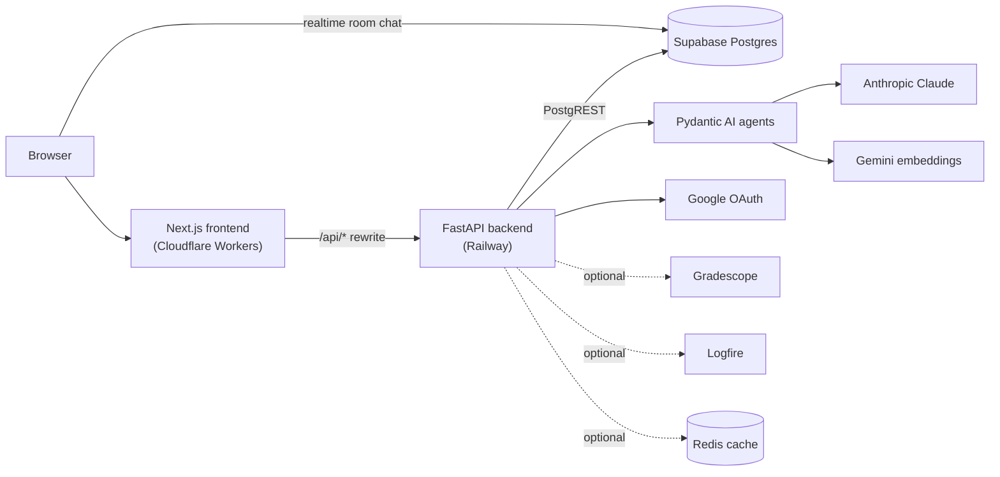

# Sapling

An AI study companion that builds a live knowledge graph of what you know as you learn.

[](https://github.com/SaplingLearn/Sapling/actions/workflows/ci.yml)
[](LICENSE)


[](docs/assets/landing.png)

## Contents

- [What Sapling does](#what-sapling-does)
- [Using Sapling](#using-sapling)
- [Features](#features)
- [Tech stack and architecture](#tech-stack-and-architecture)
- [Getting started](#getting-started)
- [Environment variables](#environment-variables)
- [Tests and CI](#tests-and-ci)
- [Repository layout](#repository-layout)
- [Contributing](#contributing)
- [Project docs](#project-docs)
- [Team](#team)
- [License](#license)

## What Sapling does

Students upload their course material (syllabi, lecture slides, notes, past exams). Sapling reads it, extracts the concepts, and grounds everything else in it: an AI tutor with three teaching modes, adaptive quizzes, flashcards, exam study guides, and a gradebook. Every session and quiz updates a per-student knowledge graph, so you can see what you have mastered and what still needs work.

Material uploaded by one student grounds the tutor and quizzes for everyone enrolled in the same course, so a class builds a shared, course-specific corpus instead of getting generic AI answers.

**Planning and tracking**

- Product scope (problem statement, MVP scope, success criteria): [Google Drive](https://drive.google.com/file/d/1sjQgW3obct6FgNlhzF1RXxDxDOU2VpNg/view?usp=sharing)
- Backlog with user stories and acceptance criteria: [Notion](https://app.notion.com/p/Sapling-3cd780cd9453802db54fe5a04ccf27a8)
- Ticket tracker, linked to the Notion backlog: [Canopy](https://canopy.saplinglearn.com/#tickets) (GitHub sign-in; open to repo collaborators)
- Code-level tasks: [GitHub Issues](https://github.com/SaplingLearn/Sapling/issues)

## Using Sapling

A typical first session, with screenshots from the app running on seeded demo data:

1. **Sign in and onboard.** Sign in with Google, then pick your school, major, year, and courses.
2. **Upload your course material.** In the **Library**, upload a syllabus or lecture PDF. Sapling streams its progress live ("Classifying...", "Extracting summary, concepts, and syllabus...", "Saved."), pulls assignments and deadlines into your calendar, and adds the concepts to your knowledge graph.
3. **Learn with the tutor.** Open **Tutor**, choose a concept, and pick a mode: *Socratic* (guided questions), *Expository* (direct explanation), or *Teach-back* (you explain, Sapling corrects). The side panel shows where the concept sits in your graph.
4. **Check yourself.** Take a **Quiz** that targets your weakest concepts, or study **Flashcards** with spaced repetition.
5. **Watch the graph grow.** The **Tree** view shows mastery across courses. Nodes shift from "not started" to "mastered" as you study.
6. **Prepare for exams.** Generate a **Study guide** for an upcoming exam from your uploaded material, and track your grade in **Grades**.

| Tutor | Quiz |
| --- | --- |
|  |  |
| **Knowledge graph** | **Library** |
|  |  |
| **Study guide** | **Gradebook** |
|  |  |
| **Notetaker** | **Study rooms** |
|  |  |

More screens (calendar, planner, achievements, study hub) are in [`frontend/public/gallery/`](frontend/public/gallery/). To regenerate them from a local stack, run `make gallery-shots`.

## Features

- **Live knowledge graph:** a D3 force graph of every concept you've touched, colored by course and shaded by mastery. Updates after every session and quiz.
- **AI tutor:** Socratic, Expository, and Teach-back modes, grounded in your course's uploaded material (retrieval-augmented). Renders math (KaTeX), Mermaid diagrams, function plots, and theorem callouts.
- **Adaptive quizzes:** questions aimed at your weakest concepts, with difficulty that scales to your performance and spaced repetition that brings back what you missed.
- **Flashcards:** generate per course, or import from paste, CSV/Markdown/Anki files, a URL, an AI prompt, or a photo. Rate cards Easy / Hard / Forgot.
- **Document library:** upload PDFs and notes up to 100 MB. Sapling extracts summaries, concept notes, and syllabus data, with OCR for scanned pages.
- **Study guides:** exam guides generated from your course material, cached per exam and regenerable.
- **Gradebook and Gradescope sync:** categories, weights, letter scales, and a current-grade calculation. Syllabus upload fills in categories and assignments. Optional Gradescope import, including BU SSO + Duo sign-in.
- **Calendar:** assignments and deadlines extracted from your syllabus.
- **Notetaker:** typed notes per course with autosave. Per note: AI summary, concept extraction into your graph, a note-grounded chat, send-to-tutor, and a quiz on the note's weakest concept.
- **Study rooms:** invite classmates, compare graphs, and chat in real time.
- **Class intelligence:** anonymized class-wide patterns that surface common misconceptions.
- **Profiles, achievements, and cosmetics:** milestones, avatar frames, name colors, and title flairs.
- **Admin panel:** role-based access, user approval, and per-student feature flags.

## Tech stack and architecture

| Layer | Technology |
| --- | --- |
| Frontend | Next.js 16 (App Router, TypeScript), D3.js for the graph, Vitest + React Testing Library |
| Backend | FastAPI (Python 3.12+), Pydantic AI agents for every LLM call |
| AI | Anthropic Claude for all agents by default (`claude-haiku-5-5` for extraction/quiz/notes, `claude-sonnet-5-5` for the tutor; [ADR 0030](docs/decisions/0030-swap-the-agents-llm-provider-from-gemini-to-anthropic-claude.md)). Google Gemini serves RAG embeddings, and any agent can be pointed back at a `gemini-*` model per task via `SAPLING_MODEL_<TASK>`. |
| Database | Supabase (PostgreSQL + pgvector), accessed through PostgREST. Row Level Security on all tables. |
| Security | Google OAuth, HMAC-signed session cookies, AES-256-GCM column encryption for PII and student content. See [SECURITY.md](SECURITY.md). |
| Streaming | Server-Sent Events (`sse-starlette`) for upload progress and the streaming tutor |
| OCR | Docling, with GOT-OCR 2.0 and Tesseract fallbacks |
| Observability | Logfire traces (with a scrubber that strips student content before export), optional PostHog analytics |
| Deploy | Frontend on Cloudflare Workers (`@opennextjs/cloudflare`). Backend API and job worker on Railway. Separate staging and production environments. |



Request paths, the data model, and known sharp edges are in [`docs/architecture.md`](docs/architecture.md). The full route list is in [`docs/api.md`](docs/api.md), and the running backend serves interactive OpenAPI docs at `http://localhost:5000/docs`.

## Getting started

### Prerequisites

- **Python 3.12+** (CI uses 3.13)
- **Node.js 22** with npm 10.9.x. The frontend enforces this with `engine-strict` (see `frontend/.nvmrc`).
- **API keys:** an [Anthropic API key](https://console.anthropic.com/) and a [Gemini API key](https://aistudio.google.com/apikey). The backend refuses to start without both.
- **Google OAuth client** (Google sign-in is the only login path). Add `http://localhost:5000/api/auth/google/callback` as an authorized redirect URI.
- **A database:** either a local Supabase stack via the Supabase CLI and Docker or Podman (Option A), or your own hosted Supabase project (Option B).

| Service | Used for | Needed locally? |
| --- | --- | --- |
| Anthropic API | Tutor, quizzes, document extraction, notes | Yes |
| Google Gemini API | RAG embeddings | Yes |
| Supabase | Postgres database, realtime room chat | Yes (local stack or hosted) |
| Google Cloud OAuth client | Sign-in, Calendar | Yes, to sign in |
| Logfire, PostHog, Redis, Gradescope | Tracing, analytics, cache, grade sync | Optional |
| Railway, Cloudflare | Hosting | No (deploy only) |

### 1. Clone

```bash
git clone https://github.com/SaplingLearn/Sapling.git
cd Sapling
```

### 2. Start a database

**Option A: local Supabase (recommended).** Follow [`docs/local-supabase.md`](docs/local-supabase.md) to start the stack and apply migrations. The `*.env.local.example` templates are already wired to it.

**Option B: your own Supabase project.** Use the `.env.example` templates instead, set `SUPABASE_URL`, `SUPABASE_SERVICE_KEY`, `ENCRYPTION_KEY`, and `SUPABASE_DB_URL` (the session-mode pooler URI), then create the schema with `python -m db.migrate` from `backend/`.

### 3. Run the backend

```bash
cd backend
python -m venv venv
source venv/bin/activate              # Windows PowerShell: venv\Scripts\Activate.ps1
pip install -r requirements.txt
cp .env.local.example .env            # Option B: cp .env.example .env
# Fill in ANTHROPIC_API_KEY, GEMINI_API_KEY, GOOGLE_CLIENT_ID, GOOGLE_CLIENT_SECRET
python main.py                        # http://localhost:5000  (API docs at /docs)
```

Optional extras: `pip install -r requirements-worker.txt` for Docling/torch OCR of scanned PDFs, and `playwright install chromium` for Gradescope BU SSO sync.

### 4. Run the frontend

```bash
cd frontend
npm install
cp .env.local.example .env.local      # Option B: cp .env.example .env.local
npm run dev                           # http://localhost:3000
```

Open http://localhost:3000 and sign in with Google.

### Or run everything with Docker

With `backend/.env` filled in and `ENCRYPTION_KEY` exported in your shell:

```bash
docker-compose up
```

### Troubleshooting

- **`RuntimeError: Missing required configuration`** on backend start: a required key in `backend/.env` is empty. The message names it.
- **401 after Google sign-in succeeds:** `SESSION_SECRET` differs between `backend/.env` and `frontend/.env.local`. They must match.
- **`npm install` fails with an engine error:** you're not on Node 22 / npm 10.9. Run `nvm use` in `frontend/`.

Setup last verified from a fresh clone by Jack He, 10/6/2026.

## Environment variables

Copy the example files as described above. Never commit real `.env` files; only the `*.example` templates are tracked. Each template documents its variables inline. These are the ones you will touch most:

**`backend/.env`**

| Variable | Required | Description |
| --- | --- | --- |
| `ANTHROPIC_API_KEY` | Yes | Anthropic key. Every agent runs on Claude by default. |
| `GEMINI_API_KEY` | Yes | Gemini key. Used for RAG embeddings and any agent slot pointed at a `gemini-*` model. |
| `SUPABASE_URL` | Yes | Supabase project URL |
| `SUPABASE_SERVICE_KEY` | Yes | Supabase service role key |
| `ENCRYPTION_KEY` | Yes | AES-256-GCM key, 64 hex chars. Generate with `python -c "import secrets; print(secrets.token_hex(32))"` |
| `SESSION_SECRET` | Outside local dev | HMAC secret for session tokens (32+ bytes). Must match the frontend. |
| `GOOGLE_CLIENT_ID` / `GOOGLE_CLIENT_SECRET` | To sign in | Google OAuth client |
| `GOOGLE_AUTH_REDIRECT_URI` | | Sign-in callback (default `http://localhost:5000/api/auth/google/callback`) |
| `GOOGLE_REDIRECT_URI` | | Calendar callback (default `http://localhost:5000/api/calendar/callback`) |
| `APP_ENV` | | `local` for development (relaxes `SESSION_SECRET`), `staging`, or `production` (default, fail-closed) |
| `PORT` / `FRONTEND_URL` | | Backend port (default `5000`) and allowed CORS origin (default `http://localhost:3000`) |
| `ALLOWED_EMAIL_DOMAINS` | | Comma-separated sign-in allowlist (default `bu.edu`; empty allows any domain) |
| `SUPABASE_DB_URL` | For migrations | Session-mode pooler URI (port 5432). Used only by `python -m db.migrate`. |
| `SAPLING_MODEL_<TASK>` | | Per-agent model override, e.g. `SAPLING_MODEL_CHAT_TUTOR=claude-sonnet-5-5`. Tasks: `CLASSIFIER`, `SUMMARY`, `CONCEPTS`, `TOPIC_CHECKLIST`, `SYLLABUS`, `QUIZ`, `CHAT_TUTOR`, `NOTE_SUMMARY`, `NOTE_CONCEPTS`, `NOTE_CHAT`. Defaults live in `backend/agents/_providers.py`. |
| `OCR_ENGINE` | | `docling` (default), `auto` (adds GOT-OCR for math), or `tesseract` |
| `GOT_OCR_ENABLED`, `GEMINI_VISION_OCR_ENABLED`, `GEMINI_VISION_OCR_MAX_PAGES` | | OCR fallbacks for handwriting/math and scanned pages |
| `LOGFIRE_TOKEN`, `POSTHOG_PROJECT_TOKEN`, `REDIS_URL` | | Optional tracing, analytics, and cross-worker cache. Unset means off. |

**`frontend/.env.local`**

| Variable | Required | Description |
| --- | --- | --- |
| `BACKEND_URL` | Yes | Backend origin for the `/api/*` rewrite (locally `http://localhost:5000`) |
| `SESSION_SECRET` | Yes | Same value as the backend |
| `NEXT_PUBLIC_SUPABASE_URL` / `NEXT_PUBLIC_SUPABASE_ANON_KEY` | Yes | Supabase realtime for study-room chat |
| `NEXT_PUBLIC_API_URL` | | Leave empty so API calls stay same-origin |
| `NEXT_PUBLIC_POSTHOG_KEY` | | Optional product analytics |

## Tests and CI

**Backend:** pytest with mocked Supabase and LLM calls, plus ruff.

```bash
cd backend
python -m pytest tests/ -q --ignore=tests/evals
ruff check .
```

**Frontend:** Vitest. Logic tests run in node; component tests use jsdom + React Testing Library.

```bash
cd frontend
npm run lint
npm run typecheck
npm test
```

**Agent evals:** accuracy checks for the LLM agents, replayed offline from recorded cassettes and gated against committed baselines. See [`backend/tests/evals/README.md`](backend/tests/evals/README.md).

```bash
cd backend
python tests/evals/run_all.py
```

**CI/CD** (GitHub Actions, `.github/workflows/`):

| Workflow | Runs | What it checks |
| --- | --- | --- |
| `CI` | Every PR and push to `main` | Backend pytest + ruff (from the hash-pinned `requirements.lock`, including a code-size ratchet test), frontend eslint + typecheck + vitest |
| `PR hygiene` | Every PR | Conventional PR title, user story + acceptance criteria on `feat`/`fix` PRs, auto type label |
| `integration (local supabase)` | PRs and pushes to `main` | Backend against a real local Supabase stack |
| `e2e (browser lane)` | Pushes to `main`, manual | Playwright end-to-end tests against the full stack |
| `Evals` | PRs touching agents | Offline agent eval harness |
| `Migrate (staging)` | Pushes to `main` that add migrations | Applies new migrations to staging |
| `Claude Code Review` | PRs | Automated review comments |

Deploys: the frontend is built and deployed by Cloudflare Workers Builds on push. Production releases go through `make promote` (preflight, backup, migrate, merge `main` into `production`, verify). See [`backend/promotion/README.md`](backend/promotion/README.md).

## Repository layout

```
Sapling/
├── backend/                FastAPI app
│   ├── main.py             App setup and router mounts
│   ├── routes/             HTTP endpoints, one module per area (learn, quiz, documents, ...)
│   ├── services/           Business logic (graph, RAG, encryption, academics, ...)
│   ├── agents/             Pydantic AI agents; model routing in _providers.py
│   ├── db/                 connection.py (the only Supabase entry point), migrations/, migrate.py
│   ├── worker/             Background job worker (uploads, indexing, Gradescope sync)
│   └── tests/              pytest suite, fixtures in conftest.py, evals/
├── frontend/               Next.js app
│   └── src/
│       ├── app/            Routes (App Router)
│       ├── components/     UI, grouped by responsibility
│       └── lib/            API client, SSE consumer, shared types
├── supabase/               Local Supabase stack config
├── docs/                   Architecture, ADRs, API reference, runbooks, audits
├── specs/                  Feature specs referenced by code and CI
├── scripts/                Local stack, E2E, and screenshot scripts
├── loadtest/               Locust load tests
└── .github/                CI workflows, PR and issue templates
```

## Contributing

Read [CONTRIBUTING.md](CONTRIBUTING.md) before opening a PR. In short:

- One branch per issue, named `<type>/<short-name>` (`feat/quiz-pager`, `fix/graph-links`).
- Conventional Commit messages and PR titles: `type(scope): subject`.
- `feat` and `fix` PRs carry a user story, acceptance criteria, and screenshots for UI changes (the PR template has the sections).
- A teammate reviews and approves every PR, CI passes, then squash and merge.

Conventions that keep the codebase consistent:

- All Supabase access goes through `backend/db/connection.py::table()`.
- Schema changes are new migrations in `backend/db/migrations/` (UTC timestamp prefix). Never edit an applied one or run DDL in the dashboard. See [`backend/db/migrations/README.md`](backend/db/migrations/README.md).
- Every LLM call is a Pydantic AI agent under `backend/agents/`.
- Sensitive columns are encrypted. Use the helpers in `backend/services/encryption.py` at read and write boundaries.

## Project docs

- [`docs/architecture.md`](docs/architecture.md): current system overview
- [`docs/api.md`](docs/api.md): every backend route
- [`docs/decisions/`](docs/decisions/): Architectural Decision Records (30 so far), append-only
- [`docs/attempts/`](docs/attempts/): things that didn't work, and what to try next
- [`docs/local-supabase.md`](docs/local-supabase.md): local database setup
- [`docs/staging/`](docs/staging/), [`docs/deploy/`](docs/deploy/), [`docs/releases/`](docs/releases/): environments, deploys, and release plans
- [`docs/security/`](docs/security/) and [SECURITY.md](SECURITY.md): security controls and how to report a vulnerability
- [`docs/README.md`](docs/README.md): index of everything else in `docs/`

## Team

| Name | GitHub |
| --- | --- |
| Andres Lopez | [@AndresL230](https://github.com/AndresL230) |
| Jack He | [@Darkest-Teddy](https://github.com/Darkest-Teddy) |
| Luke Cooper | [@lpcooper-arch](https://github.com/lpcooper-arch) |
| Jose Gael Cruz-Lopez | [@Jose-Gael-Cruz-Lopez](https://github.com/Jose-Gael-Cruz-Lopez) |
| Azaria Gonzales | [@azariagonzales89](https://github.com/azariagonzales89) |
| Aerim Lee | [@alee7-7](https://github.com/alee7-7) |

## License

[MIT](LICENSE) © 2026 Andres Lopez, Jack He, Luke Cooper, and Jose Gael Cruz-Lopez
