# The AI learning loop: an engineer's guide

Sapling's learning loop is the tutoring system every student gets on the
Learn and Study screens. This guide explains the whole system to an engineer
who has never seen it: what it does and why, how its parts connect, the rules
you must not break, and how to change it safely. It is a map to the code and
to the design spec, not a replacement for either.

## What the loop does

A student uploads course material. From it, Sapling drafts **check items** —
short questions with rubrics and answer keys — and puts each through
automated quality gates before any student sees it. When the student opens
Learn, the loop runs a session:

1. **Probe.** A few unaided questions find what the student already knows.
2. **Plan.** Code picks the next concepts: those whose prerequisites the
   student knows but which they do not yet know themselves. The student
   approves the plan.
3. **Teach.** A tutor model explains one step at a time. How much help it may
   give — from a focus question up to a full solution — is a rung on a fixed
   **ladder** (H0–H6), and the highest allowed rung (the **ceiling**) is
   computed in code from the student's state — never by a model, and never
   from what they write beyond a fixed check of whether it is a real attempt.
   Each further rung unlocks only after such a genuine attempt.
4. **Check.** The student answers a check item in an answer box. A grader
   model judges the answer against the rubric; code turns the verdict into
   **evidence**.
5. **Feedback**, then the next item or concept, and finally a **close**: a
   summary, one self-evaluation question and one "If …, then …" plan.

Between sessions, a **review queue** on Study brings each concept back when
its predicted recall falls toward 90%, and a **delayed post-test** — no
hints, no course passages — measures what the student retained 7 and 28 days
after they were first graded on a concept.

The core rule (spec §1): **only graded checks change what Sapling believes a
student knows.** The belief is a per-(student, concept) probability from
Bayesian Knowledge Tracing (BKT), with a separate guess and slip rate per kind
of check. It decays toward the starting value between checks along an FSRS-6
forgetting curve. Help lowers the credit an answer earns; chat never earns
any. Learning is measured by unassisted success on the next opportunity and on
delayed, tool-removed checks — never by in-session accuracy or by the belief
going up.

## Why it is built this way

The design follows a literature review and two audits, all in
[`docs/research/learning-loop/`](../research/learning-loop/):

- [AI tutor learning loop research](../research/learning-loop/AI%20tutor%20learning%20loop%20research.md)
  — the loop itself: graded, weighted evidence; per-channel BKT with decay;
  the probe → plan → step → check → feedback → close session; FSRS-6 review at
  90% retention; answer-withholding guardrails; and measuring learning with
  tool-removed, delayed checks. Its anchor result: in a 2025 field experiment
  (Bastani et al.), unrestricted GPT-4 access raised practice scores and
  *lowered* the later unassisted exam by 17%, while a tutor that gave hints
  instead of answers removed the harm.
- [ZPD lever tradeoffs and upgrades](../research/learning-loop/ZPD%20lever%20tradeoffs%20and%20upgrades.md)
  — the zone of proximal development (what a student can do with help but
  not yet alone) made operational: the H0–H6 ladder, the ceiling, the attempt
  gates and the difficulty bands (its section "Sapling ZPD policy spec").
- [The 2026-10-18 foundation audit](../research/learning-loop/2026-10-18-foundation-audit.md)
  — the mechanisms can support learning; passing tests and rising mastery
  estimates do not show that students learned.
- [The 2026-11-07 direction audit](../research/learning-loop/2026-11-07-direction-audit.md)
  — "keep the guardrails, rebuild the measuring stick": answer withholding,
  graded-only evidence and BKT plus FSRS are the evidence-aligned choices; the
  weak point is measurement (model-drafted items, peer-sourced keys, a model
  grader, a short-delay post-test). §13 rows A110, A112–A114, A124 and A126
  implement its recommendations.
- [The cost projection](../research/learning-loop/2026-11-08-loop-cost-projection.md),
  [the trial preregistration draft](../research/learning-loop/2026-11-08-within-student-trial-preregistration.md)
  and [its power simulation](../research/learning-loop/2026-11-08-trial-power-simulation.md).

What the code does **not** establish: that students learn more with the loop.
No controlled learner-outcome result exists yet; the post-test, the
learning-gain report and the within-student trial tooling exist so that one
can be produced.

## The whole system on one page

```mermaid
flowchart LR
  subgraph Content["Content: from an upload to a servable item"]
    UP["Student uploads<br/>course material"] --> IDX["Index passages<br/>(course_chunks)"]
    UP --> CON["Extract concepts<br/>(+ prerequisite edges, flag)"]
    IDX --> DRAFT["Draft check items<br/>(check_items slot)"]
    CON --> DRAFT
    DRAFT --> VAL["Validate + lint<br/>(code)"]
    VAL --> ALIGN["Alignment check<br/>(check_items_verify)"]
    ALIGN --> KEY["Blind key solve<br/>(check_items_solve)"]
    KEY --> BANK[("check_items<br/>servable, or HELD")]
  end

  subgraph Session["A Learn session (routes/learn_loop.py)"]
    PROBE["Probe"] --> PLAN["Plan<br/>(outer fringe)"]
    PLAN --> TEACH["Teach turn<br/>(loop_tutor tier, ceiling,<br/>leak strip, served scan)"]
    TEACH <--> CHECK["Check<br/>(pose item, attempts,<br/>hint ladder H0–H6)"]
    CHECK --> GRADE["grade_answer<br/>(guard → grader →<br/>second opinion)"]
    GRADE --> FB["Feedback turn"]
    FB --> TEACH
    FB --> CLOSE["Close<br/>(summary, if-then plan)"]
  end

  subgraph Evidence["Evidence: the only way belief changes"]
    WRITER["apply_graph_update<br/>(single writer)"] --> JOURNAL[("node_mastery_events<br/>append-only journal")]
    WRITER --> STATE[("learner_state<br/>BKT p_known + FSRS")]
    WRITER --> MIRROR[("graph_nodes<br/>mastery mirror")]
  end

  subgraph Later["Between sessions"]
    REVIEW["Review queue<br/>(FSRS due, interleaved)"]
    POST["Delayed post-test<br/>(7 and 28 days, no help)"]
    REPORT["Admin KPIs:<br/>learning gain, calibration,<br/>help abuse, cost per gain"]
  end

  subgraph Staff["Staff"]
    QUEUE["Check-item review queue<br/>(reports, lint, holds, audit)"]
    RETIRE["Retire item →<br/>void its evidence →<br/>recompute state"]
  end

  BANK --> PROBE
  BANK --> CHECK
  PROBE -->|probe answer| GRADE
  GRADE -->|Evidence| WRITER
  QUIZ["Quiz answers"] -->|mc Evidence| WRITER
  STATE --> PLAN
  STATE --> REVIEW
  REVIEW -->|review answer| GRADE
  JOURNAL --> POST
  POST -->|post-test answer| GRADE
  POST --> REPORT
  JOURNAL --> REPORT
  BANK --> QUEUE
  QUEUE --> RETIRE
  RETIRE --> WRITER

  KILL{{"LEARNING_LOOP_ENABLED=false<br/>→ legacy tutor, loop routes 404"}} -.-> Session
```

Every model call in the picture runs on a named slot in
`backend/agents/_providers.py`, after a per-student budget check
(`backend/services/ai_budget.py::check`); in tests and the E2E lanes the
same calls run against fixed, deterministic handlers.

## Reading map

| Page | Read it when you need |
|---|---|
| [architecture.md](architecture.md) | the module map: what each file in `backend/learning/`, the loop routes, the agents, the services and the frontend do, and how they connect |
| [flows.md](flows.md) | what happens over time: upload to servable item, a session step by step, grading and the evidence write, review, the post-test, voids, the kill switch |
| [data-model.md](data-model.md) | every learning table and SQL function: columns, what is append-only, what is encrypted, who writes it |
| [invariants.md](invariants.md) | the rules you must not break, why, and which test enforces each |
| [operations.md](operations.md) | flags, model slots and cost, migrations and their rollout order, the release verifier, every test lane with its command, running locally with real models |
| [amendments.md](amendments.md) | one line per §13 amendment, by theme and in order, with the code to read |
| [glossary.md](glossary.md) | a spec term in plain words, and its name in the code |
| [contributing.md](contributing.md) | the checklist for changing the loop safely |

## Sources of truth

In order: the code; the design spec
([`docs/superpowers/specs/2026-09-26-learning-loop-design.md`](../superpowers/specs/2026-09-26-learning-loop-design.md),
whose §13 amendments override its earlier sections); the repository's
`CLAUDE.md`; [`docs/architecture.md`](../architecture.md); the
[engineering readiness record](../operations/learning-engineering-readiness.md);
the [E2E guide](../e2e-exploration.md) and [local Supabase guide](../local-supabase.md);
the research basis above; and the ADRs in [`docs/decisions/`](../decisions/)
(0030 and 0032–0038 are the loop's). Where this guide and the code disagree,
the code wins and this guide has a bug; `backend/tests/test_learning_guide_paths.py`
fails when a path or name it cites stops existing.

## Status

The guide describes the code at commit `f9eca612` (the tip of
`feat/learning-loop-wave4`, PR #801), through §13 A137.

**Wave 4 (in progress):** A138 (segment prequestion), A139 (self-explanation
prompts), A140 (surface-varied isomorphs) and A141 (multi-concept items) are
being built and are not documented here yet.
