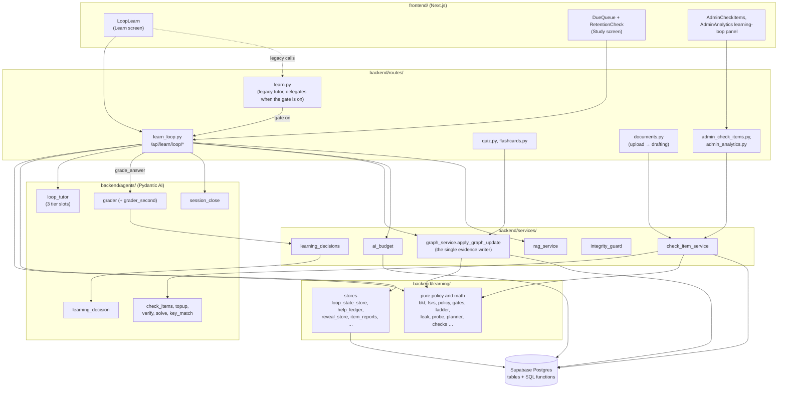

# Architecture: the module map

This page names every part of the learning loop and says how the parts
connect. For what happens over time — a request, a session, an upload — read
[flows.md](flows.md). Terms are defined in [glossary.md](glossary.md).

## Layers

The arrows are imports or calls. Two rules shape them:

1. **Policy is pure; stores do the IO.** The math and the teaching rules live
   in modules that import no database, agent or provider code, so they can be
   unit-tested exhaustively and cannot write anything by accident.
2. **One writer.** Only `backend/services/graph_service.py::apply_graph_update`
   writes the knowledge graph and the learner tables (see
   [invariants.md](invariants.md)). Routes collect `Evidence` and hand it to
   that function; nothing else writes `node_mastery_events`, `learner_state`,
   `graph_nodes` or `graph_edges`.

## `backend/learning/` — policy, math and stores

61 modules plus `backend/learning/__init__.py`. The tables group them by job and mark each **pure** (imports only
the standard library, pydantic and other `learning` modules — no database, no
agent, no network) or **IO** (reads or writes the database through
`backend/db/connection.py::table` / `rpc`, or reads config or encryption).

### The purity rules

Two tests police imports, and they are the reason the layout above holds:

- **`PURE_MODULES`** in `backend/tests/test_learning_loop_invariants.py::PURE_MODULES`
  lists 30 modules that must import nothing whose top-level package is
  `agents`, `pydantic_ai`, `google` or `db` — followed transitively through
  other `learning` modules (`test_inv_02_pure_modules_import_nothing_impure`).
  `backend/learning/ladder.py` additionally may not import `services`, `routes`, `httpx` or
  `supabase`: passage text reaches `deterministic_content` as an argument.
  Add a new pure module to that tuple; the meta test
  (`backend/tests/test_learning_invariants_meta.py`) keeps the import walker
  honest.
- **The PKG-06 layer is inert.** `policy`, `gates`, `leak`, `ladder`,
  `loop_state_store` and `zpd_events` may be imported only by a short list of
  sanctioned importers (`backend/routes/learn_loop.py`,
  `backend/learning/review.py`, `backend/learning/served_scan.py`,
  `backend/services/integrity_guard.py`, `backend/learning/stem_match.py`) plus
  a few named single imports (for example `backend/agents/grader.py` may import
  `detect_leak` alone). Booting the app with the loop router stubbed out loads
  only `learning.policy` and `learning.ladder` (through the AI budget's type
  imports). The scans are `test_zpd_layer_is_inert_nothing_imports_it` and
  `test_importing_the_app_loads_no_pkg06_module` in
  `backend/tests/test_learning_zpd_policy.py`. Why: the loop router answers
  404 before anything else when the kill switch is off, so with the layer
  reachable only through it, nothing of the tutoring policy runs anywhere.

Some modules are pure by construction but are not in `PURE_MODULES`: the
check-item core (`backend/learning/checks.py`), the answer guard
(`backend/learning/answer_guard.py`), the turn shape
(`backend/learning/turn_shape.py`), the served scan
(`backend/learning/served_scan.py`), turn activity
(`backend/learning/turn_activity.py`) and the earnest-revise reader
(`backend/learning/earnest_revise.py`). Their docstrings say they are pure;
only the listed modules are enforced, so adding one of these to the tuple is
a cheap way to make the claim a test.

### The learner model and evidence

| Module | Kind | What it does |
|---|---|---|
| `backend/learning/params.py` | pure | Every named constant (spec §3). Code cites names, never numbers. `gate_seconds` scales gate times. |
| `backend/learning/bkt.py` | pure (listed) | BKT update with per-channel guess/slip, decay at read, one-hop propagation, band and tier cuts. |
| `backend/learning/fsrs.py` | pure (listed) | FSRS-6: retrievability, intervals, next state, rating map, DASH ordering, budget selection, successive relearning. |
| `backend/learning/evidence.py` | IO (lazy) | The `Evidence` model, its weight rule and `flush_pending`, which hands the batch to the single writer. |
| `backend/learning/evidence_replay.py` | logic (imports `learner_state`, which is IO) | The writer's state transition (`observe`, `propagate`, `fsrs_after`) and the journal `replay` a void runs. Does no IO itself. |
| `backend/learning/evidence_transaction.py` | IO | The atomic evidence protocol: snapshot, plan, commit RPC, receipts, conflict retries; also the void transaction (ADR 0037, A123). |
| `backend/learning/evidence_void.py` | pure (listed) | The one void rule: which rows, poses and misconceptions a staff retire voids. |
| `backend/learning/void_store.py` | IO | Reads `learning_evidence_voids` for every evidence reader. |
| `backend/learning/learner_state.py` | IO | Reads `learner_state` (decayed); `write_metrics` is the one non-evidence write, used only by the metrics script. |
| `backend/learning/flashcard_fsrs.py` | logic (imports `services.timestamps`) | The one place a self-rated flashcard's FSRS state is computed; its two callers (`backend/routes/flashcards.py::rate_card` and `backend/learning/review.py`) write it. |
| `backend/learning/quiz_evidence.py` | pure (listed) | The quiz's stated confidence and its item-flaw gate (A132). |
| `backend/learning/quiz_plan.py` | pure (listed) | The quiz's choices from the learner model: the concept plan (A143), each question's difficulty and misconception target (A144), the skill-meter changes and the next step (A147). |
| `backend/learning/quiz_gates.py` | pure (listed) | The quiz item gates' decision (verified / practice / dropped, A145), the key comparison in code, the distractor tags and the misconception record and resolve rules (A146). |
| `backend/learning/planning_history.py` | IO | Durable planning needs read from owned evidence (ADR 0035). |
| `backend/learning/goals.py` | IO (encryption) | Student goals: confirmed concept ids drive planning; goal prose is encrypted (ADR 0033). |

### Teaching policy (the ZPD layer and the session)

"ZPD" is the zone of proximal development: what a student can do with help
but not yet alone. The layer decides how much help a turn may give.

| Module | Kind | What it does |
|---|---|---|
| `backend/learning/policy.py` | pure (listed) | Ceiling, evidence per rung, band control and verdicts, wheelspin, worked-example-first, prerequisite repair, model tier, context policy, isomorph choice. Typed state in, decisions out; never student text. |
| `backend/learning/gates.py` | pure (listed) | Genuine attempt (standard and strict), rung unlock, the H6 gate, the hint offer. The only policy code that reads student text, through fixed phrase lists. |
| `backend/learning/ladder.py` | pure (listed) | The rungs H0–H6, their intent text, the check pose and deterministic help content. |
| `backend/learning/leak.py` | pure (listed) | Deterministic answer-leak detector (n-gram, final answer, stem rules) and the served path's span check (`leak_spans`). It masks nothing in place: the unused stripper was removed (A142). |
| `backend/learning/turn_shape.py` | pure | The tutor's structured turn (`LoopTurnOut`, `LoopTurnOutV2`), its limits and rendering. |
| `backend/learning/probe.py` | pure (listed) | The adaptive diagnostic: next item, stop rules, novice floor, summaries. |
| `backend/learning/planner.py` | pure (listed) | Outer fringe, goal scope, the session plan. |
| `backend/learning/arms.py` | pure (listed) | Within-student trial arms: concept → variant. |
| `backend/learning/interleave.py` | pure (listed) | Confusable partners and the review serve order (A114). |
| `backend/learning/loop_state_store.py` | IO | Load and save `sessions.loop_state` by compare-and-set; the seen, revealed and reported sets; evidence spans and windows. |
| `backend/learning/zpd_events.py` | IO (events) | Typed emitters for `zpd.*` events; payloads are ids, counts and enums only. |
| `backend/learning/turn_activity.py` | pure | Durable timing and fencing of a tutor turn (ADR 0036). |
| `backend/learning/grade_checkpoint.py` | IO (encryption) | Sealed, owner-bound grade checkpoints for crash recovery (ADR 0038). |
| `backend/learning/misconceptions.py` | IO | The slip / misconception / novice rule, the store, confrontation markers, re-check after release, resolution, class rollup. |
| `backend/learning/learner_brief.py` | IO | Builds and stores the bounded learner brief. |
| `backend/learning/session_close.py` | IO | Close draft, deterministic fallback, normalisation, encrypted store; the insert-if-missing session helper. |
| `backend/learning/review.py` | IO | The daily review queue: due items, budget, interleaving, claims, grading. |
| `backend/learning/gate.py` | config | The kill switch: `learning_loop_active`, `learning_loop_for_request`. |
| `backend/learning/prequestion.py` | pure (listed) | The segment prequestion (A138): when a segment opens, the skip rules, the item choice with its pool rule, the pose and the answer lead. |
| `backend/learning/prequestion_store.py` | IO (encryption) | `learning_prequestions`: one row per answered prequestion, the guess encrypted; also the release read A76's re-check rule makes. |
| `backend/learning/self_explain.py` | pure (listed) | Self-explanation prompts (A139): the junctures decided in code, the four prompts, the once-per-concept cap. |
| `backend/learning/self_explain_store.py` | IO (encryption) | `learning_self_explanations`: one row per served prompt; the reply encrypted. |

### Answer withholding and integrity

| Module | Kind | What it does |
|---|---|---|
| `backend/learning/answer_guard.py` | pure | The pre-grader guard: refuses text addressed to the grader, flags suspicion, detects disowned answers (A33, A97). |
| `backend/learning/_confusables.py` | pure (generated) | Unicode look-alike table for the guard; regenerate with `backend/scripts/build_confusables.py`, never edit. |
| `backend/learning/_number_words.py` | pure (data) | English number words for the strict leak mode. |
| `backend/learning/served_scan.py` | pure | Compiles the per-turn scan of served text against open posed items (A101, A105). |
| `backend/learning/stem_match.py` | pure (listed) | Does a pasted text quote a posed item's stem (A125)? |
| `backend/learning/help_ledger.py` | IO | Per-student help rows: what was served, the help floor, open poses (A93). |
| `backend/learning/reveal_store.py` | IO | Durable reveals and fail-closed "unscanned" markers (A88). |

### Check items and their quality

| Module | Kind | What it does |
|---|---|---|
| `backend/learning/checks.py` | pure | Item models, identity, validation and repair of drafts, answer tokens, holds, serve quality, selection, post-test reserves, the matched pretest. |
| `backend/learning/item_lint.py` | pure (listed) | Item-flaw linter (A113). |
| `backend/learning/item_alignment.py` | pure (listed) | Applies the alignment check's answers (A119). |
| `backend/learning/item_keys.py` | pure (listed) | Compares the blind solve with the key (A124). |
| `backend/learning/item_audit.py` | pure (listed) | Stratified audit sample and the Wilson key-error rate (A124). |
| `backend/learning/item_stats.py` | pure (listed) | Classical item statistics from the journal (A131). |
| `backend/learning/item_reports.py` | IO | Student reports and staff review decisions (A113, A123). |
| `backend/learning/surface.py` | pure (listed) | The surface descriptor (representation and scenario) of a varied item, and the cue-familiarity dial pickers rank by (A140). |
| `backend/learning/multi_concept.py` | pure (listed) | Multi-concept items (A141): the combination key, which combinations to draft, the proficiency gate and the session dial. |

### Measurement

| Module | Kind | What it does |
|---|---|---|
| `backend/learning/learning_gain.py` | pure (listed) | Post-test windows, pre/post pairs, the funnel, bootstrap intervals (A112, A126). |
| `backend/learning/posttest_store.py` | IO | Concept anchors through the `posttest_anchors` SQL function. |
| `backend/learning/calibration.py` | pure (listed) | BKT predictions against unassisted outcomes; stated-confidence calibration. |
| `backend/learning/help_abuse.py` | pure (listed) | Bottom-outs and their pace (A133). |
| `backend/learning/earnest_revise.py` | pure | The earnest-revise gate's reader (A109). |
| `backend/learning/cost_per_gain.py` | pure (listed) | Loop spend against learning-gain pairs (A137). |
| `backend/learning/self_explain_report.py` | pure (listed) | The self-explanation report: prompts shown, replied, skipped, and the next item's unassisted success after a reply or not (A139). |
| `backend/learning/multi_concept_report.py` | pure (listed) | Multi-concept items stored, held, served and answered, with a Wilson interval on the correct rate (A141). |

## `backend/routes/learn_loop.py` — the loop's HTTP surface

One 8,900-line module, mounted at `/api/learn/loop` by `backend/main.py`. Its
docstring states its rules; the main ones:

- Every route is `require_self` (the session user must be the `user_id` in the
  request) and gated: when `learning.gate.learning_loop_for_request` is false
  it answers `404 {"detail": "learning loop not enabled"}`. The one exception
  is `GET /review/active`, the frontend's status probe, which answers
  `200 {"active": false}` instead (A78). The gate is read once per request,
  at entry.
- Every route that can run a model carries the rate limit
  (`_RATE_LIMITED`); routes that take student text also run the crisis screen
  first (`_screened`).
- `loop_state` is written only through `update_loop_state` (compare-and-set)
  with a closure that has no side effects; events and message rows follow the
  save.
- Evidence is written only by the explicit-submission handlers (A16,
  invariant 26). The active item's reference answer lives only on the turn
  object (`_LoopTurn`) — never in deps, the prompt prefix, a log line or an
  event.

The file is organised in banner-commented sections (`# ── … ──`). In order:

| Section | Main contents |
|---|---|
| Loop state | `_load_loop_state`, `_update_loop_state`, phase helpers, `_require_no_pending_feedback` |
| Learner state, band, ceiling | `_learner_view`, `_band_for`, `_ceiling_for`, `_genuine` |
| Context and run assembly | `_context_blocks`, `_prepare_loop_run`, failed-retrieval notices (A128), the tool-less continuation |
| The served text | `served_model_text`, `served_template`, `loop_leak_rung` — what the student actually receives (A48) |
| Served reveals of open, posed items | `stated_items`, `_persist_reveals`, `_reveal_floor` (A88, A93); the scan set itself, `posed_items`, lives in `backend/services/loop_posed.py::posed_items` (A149: the integrity guard reads it too) |
| The served session close | `served_close`, `close_states_answer` |
| The turn | `_LoopTurn` (one turn, JSON and streamed), the misconception confrontation line |
| Item activation and the current concept | `_activate_next_item`, `_advance_cursor`, `_isomorph_after_unknown` (A27); the multi-concept pick and the familiarity order (A140, A141) |
| Band control on the plan | `_apply_band_control`, `_repair_cursor`, `plan_focus` (A122) |
| The segment prequestion | `_pose_prequestion`, `_posed_prequestion`, `_undo_pose` (A138) |
| The segment prequestion's answer; the self-explanation reply | `_prequestion_answer`, `_prequestion_turn`; `self_explain_reply` (A138, A139) |
| Run sites | `_run_turn_json`, `_stream_turn`, `_continue_turn` — where models actually run, each after `ai_budget.check` |
| Endpoints | the route handlers below |

### Routes

| Route | Handler | Purpose |
|---|---|---|
| `GET /status` | `status` | Restore a session's phase, plan, pending check and budget |
| `GET /sessions` | `list_open_sessions` | Open loop sessions, for resume |
| `POST /start-session`, `/start-session/stream` | `start_session`, `start_session_stream` | Open a session and serve the opener (probe or plan) |
| `POST /goal` | `set_goal` | Confirm the session's goal concepts (ADR 0033) |
| `POST /probe/next`, `/probe/answer` | `probe_next`, `probe_answer` | The diagnostic check-in; answers are graded evidence |
| `GET /plan`, `POST /plan/approve` | `plan_get`, `plan_approve` | Show and approve the plan; builds the learner brief |
| `POST /chat`, `/chat/stream` | `chat`, `chat_stream` | A teach turn (never graded) |
| `POST /check/next` | `check_next` | "Check me": pose the current concept's next item; no model call |
| `POST /step/attempt` | `step_attempt` | Record a hint-unlocking attempt (never graded) |
| `POST /hint` | `hint` | Grant the next rung if the gates allow it |
| `POST /check/answer`, `/check/answer/stream` | `check_answer`, `check_answer_stream` | Grade an explicit answer; the loop chat's only evidence path |
| `POST /action` | `action` | An `[ACTION: …]` turn (never graded) |
| `POST /rating` | `rating` | The student's "too easy / about right / too hard" rating |
| `POST /report` | `report_item` | "Report this question" (flag `item_reports`) |
| `POST /close` | `close` | Close the session (summary, self-evaluation, if-then plan) |
| `GET /review/next`, `POST /review/answer` | `review_next`, `review_answer` | The daily review queue |
| `GET /review/summary`, `GET /review/active` | `review_summary`, `review_active` | Read-only summary; the loop status probe the frontend uses |
| `POST /posttest/start`, `/posttest/answer`, `/posttest/shown` | `posttest_start`, `posttest_answer`, `posttest_shown` | The delayed, tool-removed post-test |
| `GET /posttest/due` | `posttest_due` | Is a retention check due (flag `retention_due_badge`) |
| `POST /prequestion/answer`, `/prequestion/answer/stream` | `prequestion_answer`, `prequestion_answer_stream` | Record the segment prequestion's guess (never graded) and serve the turn that explains the answer (flag `segment_prequestion`, A138) |
| `POST /self-explain` | `self_explain_reply` | Store a reply to a self-explanation prompt, or a skip (never graded; flag `self_explanation_prompts`, A139) |

`end_session` has no route of its own: `backend/routes/learn.py` calls it
when the legacy end-session route delegates. The legacy routes
(`start-session`, `chat`, `chat/stream`, `start-session/stream`, `action`,
`end-session`) each evaluate `learning_loop_for_request` once
(`backend/routes/learn.py::_loop_for`) and, when it is true, hand the tutor
body in `backend/services/tutor/` (main's #118 layout, spec §13 A149) the
loop handler of the same name, built by
`backend/routes/learn.py::_loop_delegate`; the body calls it after its crisis
screen, entry checks and rate-limit read. The spec's §9 route table predates
`/goal`, `/report`, `/posttest/shown` and `/posttest/due`.

## `backend/agents/` — the loop's model slots

Every LLM call is a Pydantic AI agent; a **slot** (task) names a model role.
`backend/agents/_providers.py` holds the defaults (`_DEFAULTS`), the Claude
effort per slot (`_ANTHROPIC_EFFORT`), the slots still on Gemini
(`LOOP_SLOTS_PENDING_CLAUDE_EVAL`) and the evidence slots
(`EVIDENCE_SLOTS`). A slot's model can be overridden with
`SAPLING_MODEL_<SLOT>` (for example `SAPLING_MODEL_GRADER`).

| Slot | Agent module | Job | Default model | Claude effort | Pending Claude eval | Function-mode handler |
|---|---|---|---|---|---|---|
| `check_items` | `backend/agents/check_items.py` | Draft items for up to three concepts per call. Four more drafters ride this slot: the `mc_reason` top-up (`backend/agents/check_items_topup.py`), and behind their flags the varied drafter and its top-up (`backend/agents/check_items_varied.py`, `backend/agents/check_items_varied_topup.py`, A140) and the combination drafter (`backend/agents/check_items_combo.py`, A141) | `gemini-2.5-flash-lite` | medium | yes | `_check_items_handler` (fixed items; varied surfaces and combinations when asked) |
| `check_items_verify` | `backend/agents/check_items_verify.py` | Alignment check: is each rubric criterion asked; which concept does the item test. The combination check (`backend/agents/check_items_combo_verify.py`, A141: is every component needed?) rides this slot | `claude-haiku-5-5` | low | no | `_verify_handler` (both) |
| `check_items_solve` | `backend/agents/check_items_solve.py` | Blind solve of each drafted item (never sees the key); the free-text key match (`backend/agents/check_items_key_match.py`) rides this slot | `claude-haiku-5-5` | medium | no | `_solve_handler` (both) |
| `grader` | `backend/agents/grader.py` | Rubric grading, one yes/no per criterion, with quoted support | `gemini-2.5-flash-lite` | low | yes | `_grader_handler` |
| `grader_second` | `backend/agents/grader.py` (same agent) | The second opinion and the span checks, on a different model | `gemini-2.5-flash` | medium | yes | `_grader_handler` |
| `learning_decision` | `backend/agents/learning_decision.py` | The loop's typed closed judgments (reason correct? which wrong key?) | `gemini-2.5-flash-lite` | low | yes | `_decision_handler` |
| `loop_tutor_lite` | `backend/agents/loop_tutor.py` | Tutor tier "lite" (not routable today: lite turns route up) | `gemini-2.5-flash-lite` | low | yes | `_loop_tutor_handler` |
| `loop_tutor` | `backend/agents/loop_tutor.py` | Tutor tier "standard" | `gemini-2.5-flash` | medium | yes | `_loop_tutor_handler` |
| `loop_tutor_deep` | `backend/agents/loop_tutor.py` | Tutor tier "deep": novice teach turns, H4/H5 hints, an active misconception, two or more failed genuine attempts | `gemini-2.5-pro` | high | yes | `_loop_tutor_handler` |
| `session_close` | `backend/agents/session_close.py` | The close: summary, one self-evaluation question, one if-then plan | `gemini-2.5-flash-lite` | low | yes | `_structured_output` (fixed close) |

The quiz (not the loop) adds one slot and one agent (A144, A145): the
planned quiz writer `backend/agents/quiz_planned.py` rides the quiz's own
`quiz` slot (`claude-haiku-5-5`; its handler `_quiz_handler` answers both
schemas), and `quiz_check` (`claude-sonnet-5-5`, effort low) runs the A119
alignment agent, the A124 solve and the key match on generated quiz
questions — a model other than the one that wrote them (the `quiz` slot's
or the request's fast/smart override), which A124 requires
(`backend/services/quiz_learning.py::checks_independent`). Neither is a loop
slot: their spend is the quiz's, outside the loop's session cost.

Handlers live in `backend/agents/function_handlers_e2e.py`; they return fixed
constants that the E2E specs assert verbatim. The observe-only `decision` slot
(`backend/agents/decision.py`, main's tutor router, ADR 0027) is not part of
the loop: the loop's judgments run on `learning_decision` through
`backend/services/learning_decisions.py` (ADR 0032).

Rules every loop agent module follows (spec §8 invariant 12): exactly one
system prompt and one `Agent(` construction per module; tier and
second-opinion slots pick the model per run. The tutor's rules ride
`instructions=` so they reach every turn (A61), and student text reaches it
only inside a nonce-delimited envelope (`backend/agents/loop_tutor.py::student_envelope`, A51).
Wave 4 added two flag-on prompt lines to the tutor, both unrecorded in the
evals so far: `backend/agents/loop_tutor.py::PREQUESTION_LINE` for the turn
that explains a prequestion's answer (with the answer as data in
`prequestion_answer_block`, A138) and
`backend/agents/loop_tutor.py::SELF_EXPLAIN_ACK_LINE`, which acknowledges a
self-explanation reply once (A139). The self-explanation prompt itself is
served by code and changes no request.

Two non-agent helpers matter as much as the agents:

- `backend/agents/tools/check.py::grade_answer` — the single grading helper.
  Routes call it; it is not a tool the tutor can call. It runs the grader
  through the decision seam, then code's checks (the `mc_reason` option
  compare and the numeric gate, A22), which can only turn a "correct" into an
  "incorrect", and appends one `Evidence` to `deps.pending_evidence`. It
  never persists.
- `backend/agents/usage.py::record_agent_usage` — every run's tokens and cost
  go to `llm_usage` (with `session_id` and `course_id` where known).

## `backend/services/` — what the loop depends on

| Service | Role in the loop |
|---|---|
| `backend/services/graph_service.py` | `apply_graph_update`, the single writer of evidence, learner state and the graph mirror; `_apply_void` for voids. |
| `backend/services/check_item_service.py` | Check-item storage (encrypted columns), drafting pipeline, holds on read, retire and confirm, drafting status; the drafting flags read once per run (`drafting_flags`) and the surfaces a concept's items use (`concept_surfaces`). |
| `backend/services/varied_practice.py` | The two wave-4 practice dials for the student being served: the cue-familiarity order (`varied_on`, `familiarity_for`, A140) and the multi-concept pick (`multi_concept_on`, `multi_concept_pick`, A141). Each fails to the plain pick on a read error. |
| `backend/services/learning_decisions.py` | The loop's typed decision seam; backends and Jev shadowing; `evidence_backend` names the grader provenance. |
| `backend/services/ai_budget.py` | Per-student caps, degradation ladder, rate limit, daily tutor-call count. Checked before every loop model run. |
| `backend/services/integrity_guard.py` | Guards the AI surfaces outside the loop against posed items (A125). |
| `backend/services/rag_service.py` | Course retrieval; `chunks_for_ids` is the only visibility-aware reader of an item's source chunks. |
| `backend/services/chat_stream.py` | `stream_structured_turn`: streams the structured tutor turn through the route's leak-cut transform, with `retract` events. |
| `backend/services/prompt_safety.py` | The untrusted-content envelope for course text and student-derived text. |
| `backend/services/quiz_ask.py` | The quiz "Ask about this" session, which starts in teach on the quiz's concept (A99). |
| `backend/services/quiz_learning.py` | The quiz in the learning system (A143–A147): the concept plan, the generation plan, the item gates on `quiz_check`, the misconception record and resolve after submit, and the results block. |
| `backend/services/concept_prereqs.py` | Prerequisite edges from uploads, behind `upload_prereq_edges` (A118). |
| `backend/services/session_modes.py` | `NOT_REVIEW`: keeps review sessions out of tutor-session readers (A73). |
| `backend/services/exam_proximity.py` | Days to the next exam: retention target and brief goal line (A13). |
| `backend/services/events_service.py` | `EVENT_TAXONOMY` and `log_event`; every `zpd.*`, `learn.*`, `review.*` event goes through it. |
| `backend/services/feature_flags.py` | The learning flags (see [operations.md](operations.md)). |
| `backend/services/encryption.py` | Column encryption at the read and write boundaries. |
| `backend/services/course_context_service.py` | With the loop on, the class summary is numbers only (A35). |

## Frontend

| File | Role |
|---|---|
| `frontend/src/components/screens/Learn.tsx` | Chooses LoopLearn or the legacy tutor from the loop status probe. A failed probe shows a retry state, never the legacy tree. |
| `frontend/src/components/learn/useLoopStatus.ts` | The probe (`GET /api/learn/loop/review/active`): `{active: true}` → LoopLearn; `{active: false}` (or a 404 from an older backend) → legacy; a 5xx, network error or 2.5 s timeout → `"error"`, a retry state. |
| `frontend/src/components/learn/LoopLearn.tsx` | The loop screen. The phase is server-driven; answers go only to `/check/answer/stream`; no model toggle is sent. |
| `frontend/src/components/learn/loopState.ts` | The UI reducer over loop events (`reduceLoopEvent`). |
| `frontend/src/components/learn/LearningScope.tsx` | Goal editor and diagnosis summary. |
| `frontend/src/components/learn/ConfidenceControl.tsx` | The 3-point stated confidence (A127). |
| `frontend/src/components/learn/ReportQuestion.tsx` | "Report this question" (A113). |
| `frontend/src/components/learn/PrequestionCard.tsx` | The segment prequestion card: "Take a guess first — this one isn't scored", a choice or a text box, "No idea" (A138). |
| `frontend/src/components/learn/SelfExplainCard.tsx` | The reply box for a "why does this follow?" prompt, with a skip (A139). |
| `frontend/src/components/learn/OptionList.tsx` | The multiple-choice options as one accessible radio group, shared by the cards (A135, A138). |
| `frontend/src/components/learn/BudgetPausedBanner.tsx` | The budget-pause banner (A20, A26). |
| `frontend/src/components/learn/DueQueue.tsx` | The daily review queue on Study. |
| `frontend/src/components/learn/RetentionCheck.tsx` | The delayed post-test on Study; records page-visibility telemetry (A126). |
| `frontend/src/context/RetentionDueContext.tsx`, `frontend/src/components/RetentionDueDot.tsx` | The "retention check due" badge, behind `retention_due_badge`. |
| `frontend/src/components/screens/Study.tsx` | Mounts DueQueue and RetentionCheck when the loop is active. |
| `frontend/src/components/screens/AdminCheckItems.tsx` | The staff review queue: flagged, reported and held items; approve, retire, audit, statistics. A multi-concept item reads "Combines A + B" (A141). |
| `frontend/src/components/screens/AdminAnalytics.tsx` | The admin learning-loop panel (`GET /api/admin/analytics/learning-loop`), with `frontend/src/components/screens/admin/HelpAbusePanel.tsx`, `frontend/src/components/screens/AdminLoopCost.tsx`, `frontend/src/components/screens/admin/SelfExplanationPanel.tsx` ("Do students explain their steps?", A139) and `frontend/src/components/screens/admin/MultiConceptPanel.tsx` (A141). |
| `frontend/src/lib/api.ts` | Every `/api/learn/loop/*` call. |
| `frontend/src/lib/quiz/useQuizHome.ts`, `frontend/src/lib/quiz/proposals.ts` | The quiz home: with `quiz_concept_plan` on, the proposals and the due queue from `GET /api/quiz/plan` (A143). |
| `frontend/src/components/quiz/results/LearningBlock.tsx` | The quiz results' skill meters, due line and next step (A147). |

## How the pieces connect

- **Gate.** Every request reads the gate once at entry. Off: the legacy tutor
  runs, `/api/learn/loop/*` answers 404, and the frontend renders the legacy
  Learn screen. See [flows.md](flows.md#7-the-kill-switch).
- **State.** A session's state is `sessions.loop_state` (JSON, versioned by
  `loop_state_rev`); a student's knowledge is `learner_state` plus the
  `node_mastery_events` journal. The first is per session and saved by
  compare-and-set; the second changes only through the single writer.
- **Models.** Routes pick the tier in code (`policy.model_tier`), check the
  budget (`ai_budget.check`) in the same function, then run the agent. The
  check pose and the H2/H4/H6 help are assembled by code, not a model.
- **Items.** Uploads draft items in a background pool
  (`check_item_service.queue_generation_for_document`). Every read for a
  student drops held items; every picker excludes the student's seen,
  revealed and reported items and the post-test reserves.
- **Measurement.** Events (`zpd.*`, `learn.*`, `review.*`) and the journal
  feed the admin KPI report and `backend/scripts/derive_zpd_metrics.py`; the
  delayed post-test feeds the learning-gain report.
