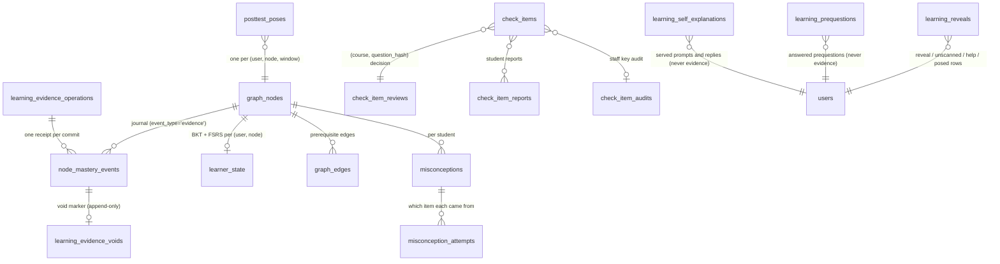

# Data model: learning tables and SQL functions

Every table the loop reads or writes, the SQL functions that guard them, and
who writes what. Schema lives in append-only migrations under
`backend/db/migrations/`; the 48 learning ones are named
`<UTC timestamp>_learning_<desc>.sql` (`backend/db/migrations/*_learning_*.sql`).
The spec's §4 ([the spec](../superpowers/specs/2026-09-26-learning-loop-design.md))
gives the original DDL; it predates most of the tables below, so the
migrations are the reference.

## Conventions used on this page

- **Encrypted** means column-level AES-GCM through
  `backend/services/encryption.py`: `encrypt_if_present` (text) or
  `encrypt_json` (JSON) at write, `decrypt_if_present` / `decrypt_json` at
  read, including before the value goes into a prompt. Never filter, join or
  put a `UNIQUE` on an encrypted column (invariant 9); look up by a plaintext
  hash column instead (`question_hash`, `wrong_key`).
- **Backend-only** means the migration turns on row-level security with no
  policy, revokes everything from `PUBLIC`, `anon` and `authenticated`, and
  grants to `service_role` (the backend's role). The base tables the loop
  extended (`node_mastery_events`, `graph_nodes`, `learner_state`,
  `check_items`, `sessions`, …) carry no RLS or grant statement in any
  migration; whatever protects them is outside the repository.
- **Append-only** is enforced one of three ways, named per table: a trigger
  that raises on `UPDATE`, grants that allow only `SELECT` and `INSERT`, or
  convention plus a test (only one SQL function inserts, and a source scan
  forbids any other writer).
- **Advisory locks.** Two Postgres advisory locks order the concurrent
  writers: the **owner lock** (`learning-evidence:<user_id>`), taken by every
  evidence or void commit for that student; and the **item lock**
  (`check-item-review:<course_id>:<question_hash>`), taken exclusively by a
  report or a staff decision and shared by every evidence commit, void
  commit and misconception record on that item. So a staff retire waits for
  grades in flight, and a grade waits for a retire.

## How the tables relate

Check items are **course assets**, keyed on `(course_id, concept_key)` and
identified course-wide by `(course_id, question_hash)`; graph nodes, learner
state and the journal are **per student**. A student's node maps to its
course's items through the normalised concept name (A2).

## Evidence and the learner model

### `node_mastery_events` — the evidence journal

The append-only log of every graded observation; everything else in this
section is derived from it.

- **Created** in `backend/db/migrations/0023_graph_integrity.sql`; the
  learning columns came with
  `backend/db/migrations/20260927024349_learning_learner_state.sql` and later
  migrations (grader backend, `evidence_seq`, planning observation, void
  replay keys, student confidence).
- **One row per evidence**, `event_type = 'evidence'`, `reason =
  'evidence:<channel>[:idk]'`, `delta = p_after − p_before` (so legacy
  readers still work).
- **Key columns:** `node_id`; `channel`; `correct`; `weight`; `assisted`;
  `max_rung` (0–6); `p_before`, `p_after`; `session_id` (NULL for quiz
  evidence); `check_item_id`, `question_hash` (plaintext); `confidence` (the
  **grader's**); `student_confidence` (the **student's** stated confidence,
  0–1, never a weight, A127/A132); `grader_backend` (`deterministic`,
  `gemini`, `gemini_second`, `claude`, `claude_second`, `jev`; A116);
  `evidence_seq` (0..n−1 within one commit, since its rows share a timestamp;
  the total order is `created_at, evidence_seq, id`, A36);
  `planning_observation` (typed provenance on loop probe and check grades,
  ADR 0035); `retention`, `same_session_recheck` and `propagated_to` (what a
  void's replay needs, A123); `multi_concept` (true on a multi-concept item's
  row, NULL on every other, A141; migration
  `backend/db/migrations/20261108205812_learning_varied_practice_review.sql`).
- **Ids** are derived from the operation (`uuid5(operation_id, seq)`), so a
  replayed commit cannot double-write.
- **A multi-concept answer (A141)** sits on the apex's node with the derived
  half `weight` journaled, so a void's replay reproduces it, and with
  `multi_concept` true, so the item statistics know it after the item's own
  row (`apex_key`, `component_keys`, what it combined) is withdrawn or
  retired. Prequestions and self-explanations write no journal row at all.
- **Append-only by convention plus tests:** only the SQL function
  `learning_evidence_commit` inserts, and invariant 1's scan forbids any
  other writer. A void never edits a row. Rows disappear only by foreign-key
  cascade when a student's node or account is deleted.
- **Not encrypted.** Ids, enums and numbers only.
- **Readers** that use it as evidence leave void rows out; readers of
  exposure (the seen and revealed sets, the re-check rule, the commit's
  exposure counts) keep them.

### `learner_state` — BKT and FSRS state per (student, concept)

- **Created** in `backend/db/migrations/20260927024349_learning_learner_state.sql`;
  primary key `(user_id, node_id)`, `node_id` cascades from `graph_nodes`.
- **Columns:** `p_known` (the stored posterior, decayed toward the prior when
  read: `backend/learning/learner_state.py::read_states`); counters
  `n_strong_unassisted`, `streak_unassisted`, `max_streak_unassisted` (A3),
  `opps`; FSRS `fsrs_d`, `fsrs_s` (CHECK: NULL or a finite positive number,
  A74), `fsrs_last_review_at`, `fsrs_due_at` (indexed with `user_id` for the
  due queue); derived metrics `htc_k`, `unassisted_next`, `assist_gap`,
  `in_zone` (A79); `last_evidence_at` (the decay anchor);
  `evidence_version` (bumped by a trigger on every update — the optimistic
  concurrency token); `evidence_touch_at` (the latest evidence or
  propagation touch: the "superseded" fence; nullable with no default, and a
  legacy NULL means unknown — never backfill it).
- **Writers:** the evidence commit (upsert), the void commit (only where a
  value changed; it never moves `evidence_touch_at`), and
  `backend/learning/learner_state.py::write_metrics` — an `UPDATE` of the four
  derived columns only, called only by `backend/scripts/derive_zpd_metrics.py`.
  There is no other writer: the unconditional `write_state` upsert was removed
  (A142), and invariant 1 refuses any module that brings one back.

### `graph_nodes` (the mirror) and `graph_edges`

- `graph_nodes.mastery_score` mirrors the latest posterior (not decayed), and
  `mastery_tier` is `bkt.tier_for` of it (unexplored, struggling, learning,
  mastered; re-derived once with the launch cuts by
  `backend/db/migrations/20261001013855_learning_rederive_mastery_tier.sql`,
  A95). The commit also bumps `times_studied` and `last_studied_at` on the
  graded node. `evidence_version` is bumped by trigger on every update.
- `graph_edges` with `relationship_type = 'prerequisite'` drive propagation,
  bands, wheelspin repair and the planner. Orientation:
  `backend/learning/params.py::EDGE_PREREQ_SOURCE_IS_PREREQ` (the source is
  the prerequisite). The evidence commit takes a `SHARE` lock on the table
  and compares the exact course-local prerequisite edge list with the plan's.
  Upload edges come from `backend/services/concept_prereqs.py` behind
  `upload_prereq_edges` (A118).
- Topology writes stay in `backend/services/graph_service.py`, in exactly
  three functions (invariant 1, A142): `apply_graph_update` (new nodes and
  edges), `delete_node` (a student's own node; `ON DELETE CASCADE` removes its
  learner state, journal, void and misconception rows with it) and
  `update_node_color`. The mirror columns are written only by the evidence
  and void commits.

### `learning_evidence_operations` — commit receipts

One row per committed evidence operation (ADR 0037): `operation_id`
(primary key), `user_id`, `course_id`, `input_fingerprint` (sha256 of the
request), the `plan` and the `changes`. A retry with the same operation id
returns the stored receipt ("replay"); a different fingerprint is a
conflict. Created by
`backend/db/migrations/20261019131339_learning_evidence_transaction.sql`;
written only inside `learning_evidence_commit`; read through
`learning_evidence_receipt`. Append-only by convention; backend-only.

### `learning_evidence_voids` — the void record

One row per journal row voided because its item was staff retired (A123):
`event_id` (primary key, references `node_mastery_events.id`, cascades),
`user_id`, `node_id`, `course_id`, `question_hash`, `check_item_id`,
`session_id`, `event_created_at`, `reason` (`'item_retired'`),
`operation_id`, `voided_at`. **Append-only, enforced twice:** the trigger
`learning_evidence_voids_no_update` raises on update, and `service_role`
holds only `SELECT` and `INSERT`
(`backend/db/migrations/20261108115157_learning_evidence_void_grants.sql`).
Written only by `learning_evidence_void_commit`; no Python module writes it
(invariant 1's void test). Readers: `backend/learning/void_store.py`, and in
SQL the void functions and `posttest_anchors`.

## Check items

### `check_items`

Course-asset questions, created in
`backend/db/migrations/20260927065932_learning_check_items.sql`.

| Column | Meaning | Encrypted |
|---|---|---|
| `id` | sha256 of course, concept key and question hash | no |
| `course_id`, `concept_key`, `document_id` | the course asset's key and its first source | no |
| `format` (`free`, `teachback`, `mc_reason`), `difficulty` (1–3) | the channel and level | no |
| `prompt`, `reference_answer`, `final_answer` | the question, its worked reference, its short final answer (A34; NULL rows are never served) | **yes** |
| `rubric_json`, `common_wrong_json` | criteria; known wrong reasons keyed by plaintext `wrong_key` | **yes** (JSON) |
| `options_json`, `correct_option` | `mc_reason` options and the key letter (A22, A37) | **yes** |
| `answer_kind` (`free`, `numeric`), `canonical_answer`, `tolerance` | numeric keys (A22) | `canonical_answer` **yes** |
| `canonical_verified` | the key is confirmed: blind solve agreed, staff approved, or an audit said correct | no |
| `stepwise`, `graded` | H4 sibling eligibility; graded coursework (always false today) | no |
| `source_chunk_ids`, `source_document_ids` | provenance; withdrawal deletes by these (A23) | no |
| `question_hash` | sha256 of the normalised **plaintext** prompt: the item's identity | no |
| `lint_flags` | NULL never linted, `{}` clean; flaw, alignment, key-hold, staff-hold and `unsourced` codes | no |
| `aligned_at`, `key_checked_at` | when the alignment and key checks ran (A119, A124) | no |
| `surface_representation` | a varied item's representation: `verbal`, `symbolic`, `numeric`, `visual` or `applied` (A140) | no |
| `surface_context` | a varied item's scenario label, at most four words (A140) | **yes** |
| `apex_key`, `component_keys` | a multi-concept item's apex and its two or three component concept keys, apex first (A141) | no |

- Unique on `(course_id, concept_key, question_hash)`; indexed by
  `(course_id, concept_key, format, difficulty)`, by source documents, and by
  `(course_id, apex_key)` for multi-concept items.
- **Wave-4 columns** (`backend/db/migrations/20261108185101_learning_varied_practice.sql`):
  all four nullable and written only when their flag is on for the uploader.
  CHECKs keep the surface descriptor whole (both or neither,
  `check_items_surface_whole`) and its representation known, and give a
  multi-concept row its shape (`check_items_multi_concept_shape`): two or
  three components, the apex first, and `concept_key` equal to the components
  joined by the ASCII unit separator — a character no single concept's key can
  hold, so no per-concept read ever meets a multi-concept item.
- **Mutable.** Writers are all in `backend/services/check_item_service.py`
  (store, lint, alignment, key check, confirm, audit, retire) plus the SQL
  report and decide functions, which write `lint_flags`.
- **The staff-hold trigger** `check_items_staff_hold` re-derives
  `reports_threshold` and `staff_retired` from `check_item_reviews` on every
  insert and on any update of `lint_flags`, `course_id` or `question_hash`.
  Python never sets or clears those two codes.

### `check_item_reviews`, `check_item_reports`, `check_item_audits`

| Table | One row per | Holds | Written by |
|---|---|---|---|
| `check_item_reviews` | course item `(course_id, question_hash)` | the current decision: `status` (`approved`, `quarantined`, `retired`), `decided_by` (`reports`, `admin`), `approved_at`; latest wins, no history | only the SQL functions `check_item_report_quarantine` and `check_item_review_decide` |
| `check_item_reports` | `(user_id, course_id, question_hash)` — a student's report of one course's item (A142: the same question in two courses shares its hash) | a student's report: `reason` (`wrong_answer`, `unclear`, `not_from_my_course`), `surface` (`loop`, `review`); no free text | `check_item_report_quarantine` (insert once) |
| `check_item_audits` | course item | a staff key verdict (`correct`, `wrong`, `ambiguous`) and the key status at the first audit | `check_item_service.record_item_audit` (upsert) |

All three are backend-only; created by
`backend/db/migrations/20261108041639_learning_item_quality.sql` and
`backend/db/migrations/20261108073631_learning_item_keys.sql`, reworked for
the quarantine by `backend/db/migrations/20261108072715_learning_evidence_void.sql`;
`backend/db/migrations/20261108193927_learning_report_course_key.sql` keys a
report on the course item (A142).
A retire is final: approving a retired item is refused.

### `check_item_draft_failures`

Bounded redrafting (A41): per `(course_id, concept_key)`, consecutive failed
drafting passes against a fingerprint of the sources (`source_fp`) and a
`solo` flag (draft this concept alone). Skipped after three failures on
unchanged sources. Fails open. Backend-only.

### `documents` (drafting columns)

`check_items_status` (`pending`, `done`, `failed`, `unavailable`) and
`check_items_at`, from
`backend/db/migrations/20261108091912_learning_document_drafting.sql` (A128).
Written by `check_item_service.mark_drafting`; read by
`check_item_service.drafting_pending`, which makes the probe and "Check me"
say "preparing" for up to two hours while the student's own upload drafts.

## Sessions, help and the post-test

### `sessions` (loop columns)

| Column | Meaning |
|---|---|
| `loop_state` (jsonb) | the session's state document: phase, plan and cursor, the probe, the steps per posed item (rung, attempts, timestamps, the grading claim), the seen/revealed id lists, review counters, goal, turn activity; with the wave-4 flags on, the prequestion records per concept and the open self-explanation prompt (ids, enums and times only, A138, A139) |
| `loop_state_rev` (bigint) | the compare-and-set token: a save filters on the loaded value and sets it plus one (A38) |
| `mode` | `review` marks a daily review session (A9, A73) |
| `close_json` | the session close — **encrypted** (JSON), written once |
| `close_phase` | where the session stopped (`probe` … `close`) |
| `loop_brief` | the learner brief — **encrypted**; NULL means not built yet |

`loop_state` itself is **plaintext** JSON and holds no prose, with two
exceptions that are ciphertext strings inside it: the goal text
(`goal.text_encrypted`, `backend/learning/goals.py::encode_goal`) and a
pending grade checkpoint (`backend/learning/grade_checkpoint.py::seal`), whose
plaintext includes the student's submitted answer. Writers:
`backend/learning/loop_state_store.py::update_loop_state` (never inserts),
`backend/learning/session_close.py::store_close` and `ensure_session_row` (the
insert-if-missing helper, A11), `store_brief`, the review session loader, and
the legacy route's `_consume_pending` (the first write of a lazy session).

### `learning_reveals` — reveals and the help ledger

One table, four kinds of row, keyed by student and `question_hash` (not by
session, so it survives any session boundary):

| `kind` | Written when | Read for |
|---|---|---|
| `reveal` | a served tutor turn stated an open posed item's answer (A88), or a segment prequestion's card closed: its answer is about to be shown, or the card was superseded (source `prequestion`, A138) | the revealed set; the help floor |
| `unscanned` | a turn's open items could not be read (fail closed) | items posed before it grade as assisted |
| `help` | a hint rung was granted or planned, or an outside surface helped (`rung` 0–6) | the help floor: `help_ledger.max_help` (A93) |
| `posed` | an item was posed, a segment prequestion's card included (source `prequestion`, A138) (`graded_at` set when graded, or when the prequestion's card closes) | the open posed items the served scan checks |

Created by `backend/db/migrations/20260930031644_learning_reveals.sql`,
extended by `backend/db/migrations/20261001010805_learning_help_ledger.sql`.
Append-only by convention except `posed.graded_at`; hashes, ids, rungs and
times only, never text. Writers: `backend/learning/reveal_store.py`,
`backend/learning/help_ledger.py`, `backend/services/quiz_ask.py` and
`backend/services/integrity_guard.py`.

### `posttest_poses` and `posttest_skips`

- `posttest_poses`: primary key `(user_id, node_id, window_days)` — one pose
  per student, concept and window. It records the item posed
  (`question_hash`), when (`posed_at`, `served_at`), the claim that makes
  grading single-shot (`claim`, `claimed_at`), the window's anchor
  (`anchor_event_id`, `anchor_at`), the delay since the concept's last
  evidence, how the item was chosen (`item_match`, `item_source`), and the
  outcome (`correct`, `max_rung`, `answered_at`, `answer_latency_s`, and the
  hidden-tab telemetry `hidden_count`, `hidden_s`). CHECKs keep outcome and
  telemetry consistent (all or none, only on an answered pose). Mutable;
  written only by the post-test handlers in `backend/routes/learn_loop.py`.
- `posttest_skips`: a due window that could not be posed and why (`no_items`,
  `exhausted`, `reported`; A126).

Both backend-only; migrations
`backend/db/migrations/20260930024005_learning_posttest_poses.sql`,
`backend/db/migrations/20261108041742_learning_posttest_windows.sql` and
`backend/db/migrations/20261108093359_learning_posttest_outcomes.sql`.

### `learning_prequestions` and `learning_self_explanations` (wave 4)

Both from `backend/db/migrations/20261108184825_learning_teach_prompts.sql`,
both backend-only, and **neither is evidence**: nothing that grades, plans or
models the learner reads them, except A76's release rule (below).

- `learning_prequestions` (A138): one row per **answered** segment
  prequestion, unique per `(user_id, session_id, node_id)`: the item posed
  (`check_item_id`, `question_hash`, `format`, `difficulty`), `no_idea`,
  `guess_json` (the guess — **encrypted**, NULL exactly when the student said
  "no idea", a CHECK), `posed_at` and `answered_at`. Written once by
  `backend/learning/prequestion_store.py::store_answer`, under the answer
  route's claim, and read back at once: the row is the answer's commit point
  (the first stored guess stands; the transcript and the event are built from
  it). `service_role` holds `SELECT` and `INSERT` only. Its other readers,
  whatever the flag says now: A76, because an answered prequestion is a release
  of that item's answer, so the next graded item on the concept (decided by
  time: nothing graded on the concept since) and the item's class-mates for a
  day count as re-checks (`backend/learning/prequestion_store.py::releases`);
  and the revealed set, `backend/learning/loop_state_store.py::revealed_hashes`,
  so the item never serves that student again even if both reveal stores
  failed.
- `learning_self_explanations` (A139): one row per **served** prompt: the
  concept, the item, the `juncture` (`worked_example`, `released_solution`,
  `first_correct`), the rung, `prompted_at`, `status` (`open`, `replied`,
  `skipped`), `closed_at`, `reply_text` (**encrypted**) and `reply_chars`.
  CHECKs tie the reply to the `replied` status and `closed_at` to a closed
  one. Written by `backend/learning/self_explain_store.py` (insert on serve;
  on reply or skip, an update that closes the row only while it is still
  `open`, so the first of two concurrent replies stands; `service_role` holds
  `SELECT`, `INSERT` and `UPDATE`); read only by the admin report
  (`backend/learning/self_explain_report.py`), which never reads the reply.

## Misconceptions

- `misconceptions`: per student, node and `wrong_key` (plaintext,
  identifier-shaped), with `count`, first and last seen, `resolved_at` and
  `resolved_reason` (`correct_unassisted_isomorph` from A127 or
  `evidence_void` from A123). At most one **open** row per key (partial
  unique index). `evidence_text` (the answer it was recorded from) is
  **encrypted** and never read back. Written by the SQL function
  `misconception_record` (atomic insert-or-increment; since A142 it records
  nothing on a node the student does not own), closed by
  `misconceptions.resolve` and by the void commit.
- `misconception_attempts`: one row per increment, naming the item it came
  from, so a void can tell which misconceptions rest only on retired items.
  Append-only by grants (`SELECT`, `INSERT` only).

## Budget, usage, quiz and flashcards

| Table | Loop role |
|---|---|
| `ai_tutor_daily_calls` | `(user_id, day)` → tutor call count, incremented atomically by `ai_budget_bump_tutor_calls` (A39); the 200-a-day cap. Backend-only. |
| `llm_usage` | every model run; the loop added `cached_tokens`, `thinking_tokens` (A21), `session_id` (A92) and `course_id` (A137), all nullable. Read by the budget, the KPIs and cost per gain. The writer drops a column the database lacks and retries. |
| `quiz_evidence_claims` | `(user_id, question_hash)` → the claim that allows one quiz evidence per rolling 24 hours (A100). Backend-only. |
| `flashcards` | FSRS columns `fsrs_d`, `fsrs_s`, `due_at`, `reps`, `lapses` (PKG-11); updated only through `flashcard_fsrs_update`. |
| `user_settings` | `loop_arm` (the trial arm label, set by SQL only); `learning_loop_beta` is retired and read by nothing in the app. |

`checklist_budget_accounts` and `checklist_budget_reservations`
(`backend/db/migrations/20261019125459_checklist_budget.sql`) belong to the
topic-checklist feature, not the loop; they shipped in the same rollout.

## SQL functions

All are `SECURITY INVOKER`, granted to `service_role` and revoked from
`PUBLIC`, `anon` and `authenticated`, except where noted. Python reaches them
through `backend/db/connection.py::rpc`.

**What each function guarantees:**

| Function | What it guarantees | Python caller |
|---|---|---|
| `learning_evidence_snapshot` | read-only, owner- and course-scoped: nodes with versions, learner rows, prerequisite edges, prior exposure counts | `backend/learning/evidence_transaction.py::commit_evidence_transaction` |
| `learning_evidence_commit` | all-or-nothing: owner lock; replay or conflict by operation id; refuses a batch touching a retired item; locks and compares edges, nodes and learner rows by version; refuses evidence older than a newer touch ("superseded"); validates every value; then writes learner state, mirror, journal and receipt. No learning arithmetic runs in SQL. | the same |
| `learning_evidence_receipt` | the receipt for an operation id, or missing / conflict | `backend/learning/evidence_transaction.py::read_receipt` |
| `learning_evidence_void_pending` | read-only: the students with un-voided evidence on an item | `backend/learning/evidence_transaction.py::void_pending` |
| `learning_evidence_void_snapshot` | read-only: the course's journal with void flags, states, edges, retired hashes, open misconceptions | `backend/learning/evidence_transaction.py::commit_void_transaction` |
| `learning_evidence_void_commit` | owner and item locks; refuses an item that is not retired; the void set must be exactly the student's rows on the item; inserts voids, writes changed states and mirrors, closes misconceptions; idempotent | the same |
| `check_item_report_quarantine` | exclusive item lock; one report per student per course item; quarantines once at two reporters (counted since the last approval) and holds every row in the same transaction | `backend/learning/item_reports.py::record_report` |
| `check_item_review_decide` | exclusive item lock; approve or retire; approving a retired item is refused; re-derives the holds | `backend/learning/item_reports.py::decide` |
| `check_item_hold_flags`, `check_items_staff_hold` | derive the staff-hold codes (the second is the trigger function) | — |
| `misconception_record` (7 arguments) | shared item lock; records nothing for a retired item or on a node the student does not own (A142); atomic insert-or-increment of the open row, plus an attempt row | `backend/learning/misconceptions.py::record` |
| `misconception_rollup` | **SECURITY DEFINER**; per course concept, the wrong keys held by at least five students, open rows only | `backend/learning/misconceptions.py::rollup` (no production caller; never a tutor tool, invariant 17) |
| `posttest_anchors` | each concept's first **non-void** evidence time, keyset-paged | `backend/learning/posttest_store.py::posttest_anchors` |
| `ai_budget_bump_tutor_calls` | a one-statement upsert-increment of the day's count | `backend/services/ai_budget.py::count_tutor_call` |
| `learning_float_probe` | constant floats, to prove PostgREST returns them exactly (A136) | the release verifier's `--rest-float-probe` |

**Where each is currently defined** (several were re-created; the
latest file in filename order wins):

| Migration | Current definition of |
|---|---|
| `backend/db/migrations/20261019141950_learning_evidence_forward_repair.sql` | `learning_evidence_snapshot` (its float setting added by `backend/db/migrations/20261108115720_learning_evidence_snapshot_exact_floats.sql`), `learning_evidence_receipt` |
| `backend/db/migrations/20261108103333_learning_evidence_commit_reconcile.sql` | `learning_evidence_commit` |
| `backend/db/migrations/20261108072715_learning_evidence_void.sql` | the three `learning_evidence_void_*` functions, `check_item_review_decide`, `check_item_hold_flags`, `check_items_staff_hold` |
| `backend/db/migrations/20261108193927_learning_report_course_key.sql` | `check_item_report_quarantine` (on the per-course-item report key) and the seven-argument `misconception_record` (A142) |
| `backend/db/migrations/20260929143810_learning_misconceptions_atomic.sql` | `misconception_rollup` |
| `backend/db/migrations/20261108105254_learning_posttest_anchors_void.sql` | `posttest_anchors` |
| `backend/db/migrations/20260929050404_learning_ai_tutor_daily_calls.sql` | `ai_budget_bump_tutor_calls` |
| `backend/db/migrations/20261108162223_learning_exact_floats.sql` | `learning_float_probe` |

**`learning_evidence_commit` has five definitions** (October's transaction
and forward repair, then wave 2's void, student-confidence and reconcile
migrations), and only the last is correct. The wave-2 three must run in one
`python -m db.migrate` run before the code
(see [operations.md](operations.md#migrations-and-their-rollout-order));
`backend/tests/test_learning_migration_functions.py` checks that every later
definition keeps what the earlier ones required.

**Triggers:** `learner_state_evidence_version` and
`graph_nodes_evidence_version` bump `evidence_version` on every update (so any
writer, including the metrics script, invalidates a plan in flight);
`check_items_staff_hold` re-derives staff holds;
`learning_evidence_voids_no_update` makes voids append-only. There is no
trigger on `node_mastery_events`, `learning_reveals`,
`misconception_attempts` or `learning_evidence_operations`.

## Encrypted learning columns, in one place

| Table | Encrypted columns |
|---|---|
| `check_items` | `prompt`, `reference_answer`, `final_answer`, `rubric_json`, `common_wrong_json`, `options_json`, `correct_option`, `canonical_answer`, `surface_context` (A140) |
| `learning_prequestions` | `guess_json` (A138) |
| `learning_self_explanations` | `reply_text` (A139) |
| `sessions` | `close_json`, `loop_brief`; inside the plaintext `loop_state`: the goal text and a pending grade checkpoint |
| `misconceptions` | `evidence_text` |
| `flashcards` | `front`, `back` (not loop-specific) |

The ciphertext oracle checks the `check_items` columns and the two wave-4
tables' (`backend/e2e_oracles/gather.py`, `_CIPHERTEXT_MANIFEST`).
Invariant 9 forbids a `UNIQUE` or an `eq.` filter on the columns it lists
(`ENCRYPTED_LEARNING_COLUMNS` in `backend/tests/test_learning_loop_invariants.py`);
that list predates wave 4 and does not yet name `surface_context`,
`guess_json` or `reply_text`, so treat them by the same rule until it does.

## The spec's §4 and the migrations

§13 A142 brought §4 up to date with the code: it now lists the tables whose
DDL lives only in their migrations, the six-value `grader_backend` CHECK
(A116), the `check_item_reports` key, the two ciphertext values inside the
plaintext `loop_state` (the goal text and a saved grade checkpoint), and that
nothing has read `learning_loop_beta` since the cutover. §4's SQL block is
still each package's record of what it wrote; for a table's current shape,
its migrations (cited above) are the reference. §8 invariant 8 now names the
one sanctioned edit to a learning migration (7717dc24, A123).
