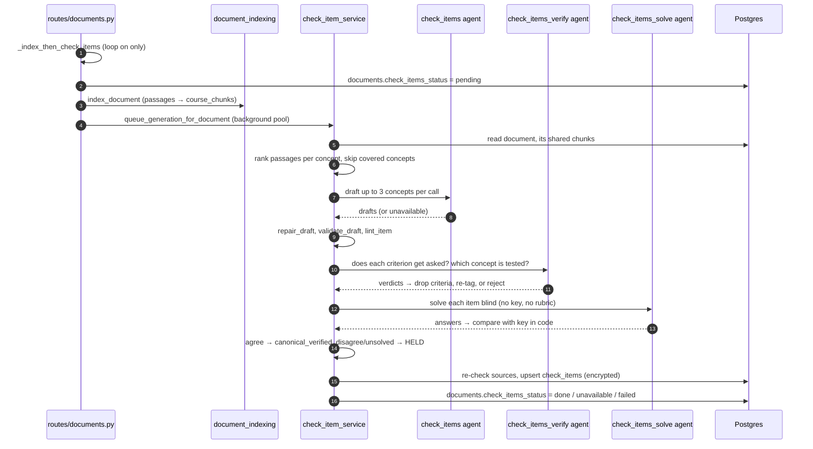
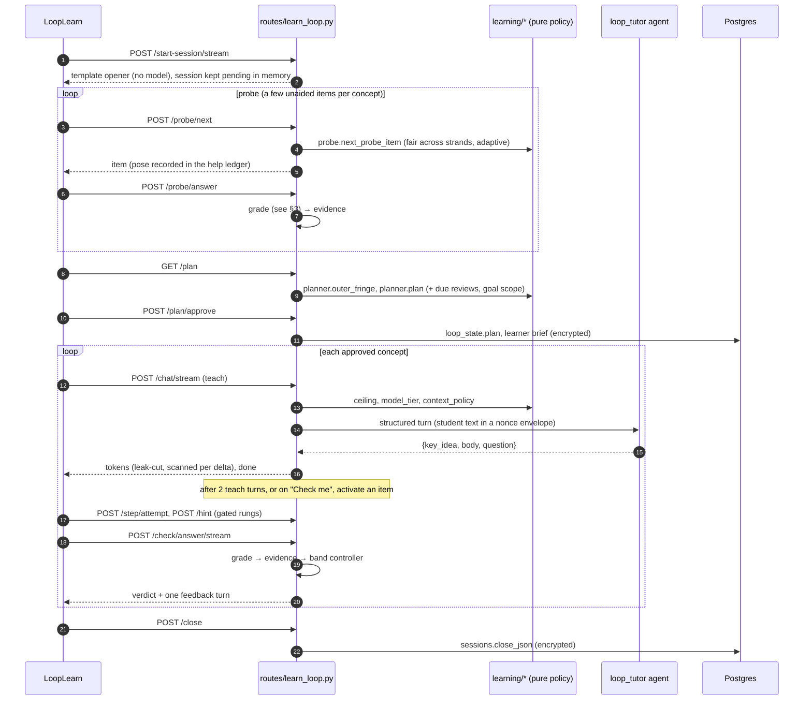
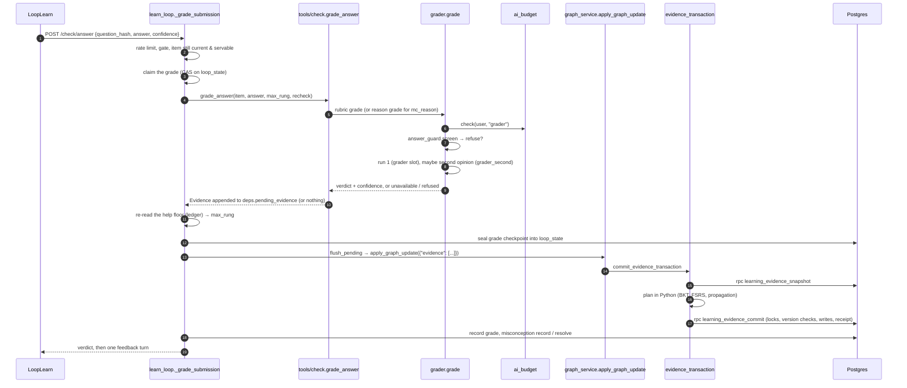
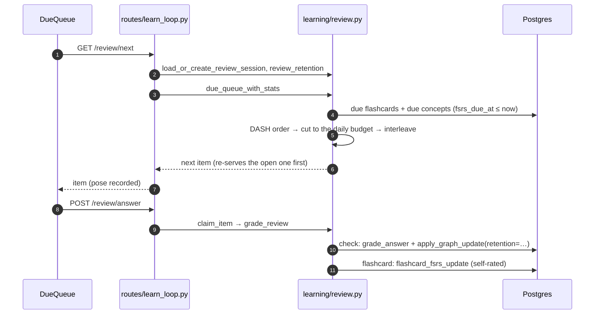
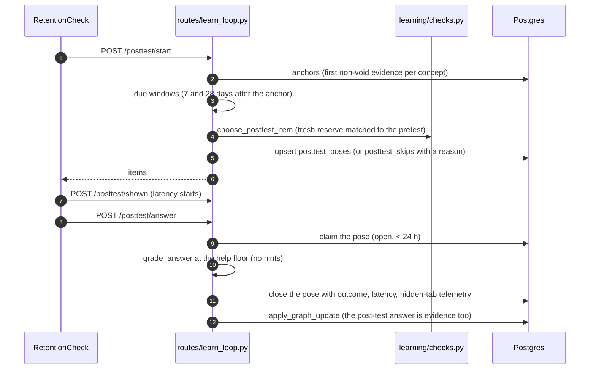
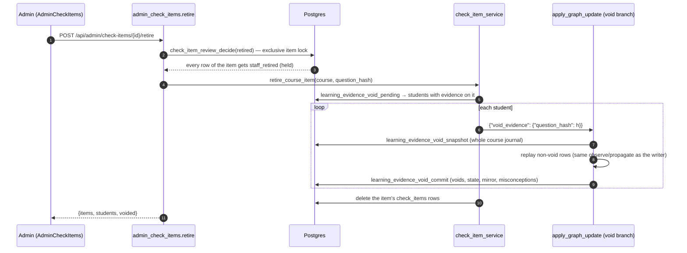
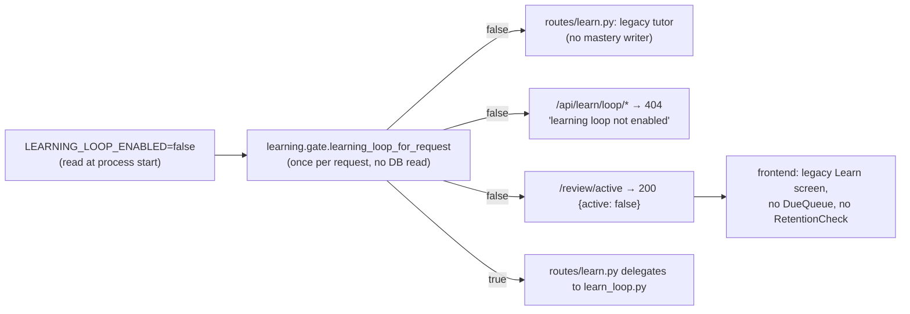
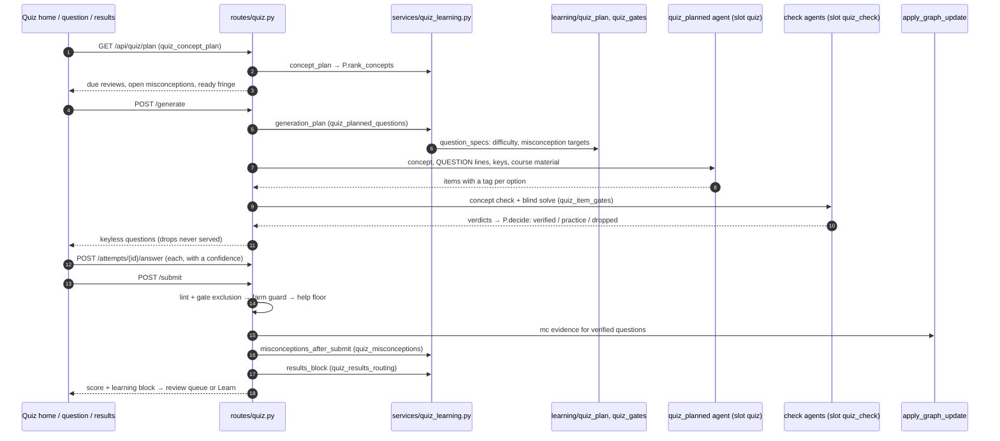

# Flows: what happens over time

Each section follows one flow end to end, with a sequence diagram and the
functions to read. The module map is in [architecture.md](architecture.md);
the tables in [data-model.md](data-model.md); terms in
[glossary.md](glossary.md). Section numbers are stable, so other pages link to
them.

1. [From an upload to a servable item](#1-from-an-upload-to-a-servable-item)
   — drafting, lint, alignment and key checks, holds
2. [A session](#2-a-session-probe--plan--teach--check--close) — probe, plan,
   teach turns, the check with its help ladder and band controller, close
3. [Grading and the evidence write](#3-grading-and-the-evidence-write) — the
   grader, the second opinion, the single writer
4. [Spaced review and confusable interleaving](#4-spaced-review-and-confusable-interleaving)
5. [The post-test windows and the learning-gain report](#5-the-post-test-windows-and-the-learning-gain-report)
6. [Voids after a staff retire](#6-voids-after-a-staff-retire)
7. [The kill switch](#7-the-kill-switch)
8. [The quiz in the learning system](#8-the-quiz-in-the-learning-system) —
   the concept plan, planned questions, item gates, misconceptions and the
   results block (A143–A147, five flags)

## 1. From an upload to a servable item

An upload turns into check items in the background. Nothing here can fail the
upload, and every quality gate fails **closed**: when a check cannot run, the
drafts are dropped, never stored unchecked.

1. **Trigger.** `backend/routes/documents.py::upload_document` (SSE) and
   `upload_document_sync` schedule
   `backend/services/documents/post_roll.py::_index_then_check_items` after the upload
   commits — only when `LEARNING_LOOP_ENABLED` is on (items are course
   assets, so this is a course-level gate, not a per-student one). It marks
   the document `pending` (`check_item_service.mark_drafting`; while it is
   pending, the uploader's loop says it is "preparing" — A128), indexes the passages
   (`backend/services/document_indexing.py::index_document`), then hands the
   document to `backend/services/check_item_service.py::queue_generation_for_document`:
   a two-thread background pool (`CHECK_ITEM_DRAFT_WORKERS`). In function mode
   it drafts inline instead. A failed index does not stop drafting.
2. **Sources (A23).** A document is a source only when its shareability is
   `course_material` and it is shared with the class
   (`check_item_service.document_is_item_source`; consent and privacy rules in
   `backend/services/chunk_visibility.py`). An indexed document gives its
   shared `course_chunks`; an unindexed one gives its extracted text, and
   items drafted from it are marked `unsourced` (A128). No source, no items.
3. **Concepts and passages.** The upload's extracted concepts, de-duplicated
   by concept key, at most `CHECK_ITEM_MAX_CONCEPTS_PER_DOC` (10). A concept
   that already has `CHECK_ITEM_INITIAL_PER_CONCEPT` (9) stored items is
   skipped. Passages are ranked per concept by shared name tokens
   (`backend/learning/checks.py::rank_chunks_for_concept`). A concept that
   failed drafting three times on unchanged sources is skipped for a while
   (`check_item_draft_failures`, A41).
4. **Draft.** `backend/agents/check_items.py::draft_items`, up to three
   concepts per call, on the `check_items` slot (Gemini Flex for background
   prefill; long timeout; 429/503 retried). It never raises: a failure is
   `CheckItemsUnavailable`, logged as `learn.check_items_failed`, and a
   multi-concept call that failed validation is split and retried one concept
   at a time. Usage is billed to the uploader (A44).
5. **Repair, validate, lint.** `backend/learning/checks.py::repair_draft` makes the
   repairs that need no guess (for `mc_reason` items, code letters the options
   and places the correct one, A37); `validate_draft` drops an invalid draft
   with its reasons; `backend/learning/item_lint.py::lint_item` stores
   item-flaw codes (it never drops: `correct_longest`, `correct_repeats_stem`,
   `all_or_none_of_above`, `duplicate_options`, `negative_stem`; A113).
6. **Alignment check (A119).** `backend/agents/check_items_verify.py::verify_items`
   asks, per item, whether the question asks for each rubric criterion and
   which listed concept it tests; `backend/learning/item_alignment.py::align`
   applies the answers in code: an unasked criterion is dropped, an item
   testing another in-scope concept is re-tagged, one testing none is
   rejected. The verifier never sees the key.
7. **Key check (A124).** `backend/agents/check_items_solve.py::solve_items`
   solves each item **blind** — the question, the options under their stored
   letters and the passages, never the key, rubric or reference — on a model
   family different from the drafter's. `backend/learning/item_keys.py::compare`
   compares in code (option letter; number within tolerance; answer tokens),
   asking `backend/agents/check_items_key_match.py::match_keys` once per batch
   for free-text pairs code cannot settle. Agreement sets
   `canonical_verified`; a different answer stores the item **held** with
   `key_disputed`, "not settled by the passages" with `key_unsolved`.
8. **Store.** Just before writing, the sources are re-checked (a document
   deleted or withdrawn from sharing meanwhile drops the drafts). The row is
   upserted on `(course_id, concept_key, question_hash)` with its text columns
   encrypted; an item staff already retired is not re-stored, and one under a
   report quarantine is stored held. A source withdrawn after the write
   retires every item citing it (`retire_items_for_documents`).
9. **Top-up (A37).** A concept left with fewer than two servable `mc_reason`
   items gets one focused call
   (`backend/agents/check_items_topup.py::draft_mc_topup`) through the same
   gates.
10. **Status.** The document is marked `done`, `unavailable` (some concept
    could not be drafted) or `failed`; the "preparing" notice ends.

### Two drafting variants behind flags (wave 4)

Both flags are read once per drafting run for the **uploader**
(`backend/services/check_item_service.py::drafting_flags`; the backfill has no
student, so it is always plain). Off, every drafting request, fingerprint,
stored row and pick is byte-identical to before wave 4 (pinned by
`backend/tests/test_learning_varied_drafting.py` and
`backend/tests/test_learning_varied_serving.py`).

- **Surface-varied isomorphs** (`varied_isomorphs`, A140). The drafter and the
  top-up are replaced by `backend/agents/check_items_varied.py` and
  `backend/agents/check_items_varied_topup.py`: one prompt each, asking that
  a concept's items be the same idea at the same depth on different
  scenarios and, where the concept allows, different representations, and
  telling the model which surfaces the concept's stored items already use
  (`check_item_service.used_surfaces`). Each item carries a **surface
  descriptor**: a representation (verbal, symbolic, numeric, visual, applied;
  stored in plaintext) and a short scenario label (at most four words,
  **encrypted**) (`backend/learning/surface.py`). The lint, alignment and key
  checks run unchanged and never see the descriptor.
- **Multi-concept items** (`multi_concept_items`, A141). After the document's
  own concepts, `check_item_service.generate_combos_for_document` drafts
  **combinations**: an apex concept from the document with one or two of its
  direct prerequisites in the uploader's course graph
  (`backend/learning/multi_concept.py::combinations`; at most three per apex
  and six per document, two-concept ones first). A combination is drafted only
  when the document's passages discuss every component.
  `backend/agents/check_items_combo.py` writes one item per format at
  difficulty 3, each needing every component together. A combination
  alignment check (`backend/agents/check_items_combo_verify.py`, applied by
  `backend/learning/item_alignment.py::align_components`) rejects an item that
  one of its components is not needed for, and never re-tags it; the blind key
  check then runs as for any item. The item is stored under a joined concept
  key with `apex_key` and `component_keys`, so no single concept's read,
  probe, review, H4 sibling or post-test ever meets it. Combinations come only
  from prerequisite edges, so this does nothing unless the uploader also has
  `upload_prereq_edges` (A118).

### Holds and what readers do with them

A **hold** is a code in `check_items.lint_flags` that keeps an item from
every student (`backend/learning/checks.py::held_flags`):

| Hold | Set by | Lifted by |
|---|---|---|
| `key_disputed`, `key_unsolved` | the blind key check | an admin approve or a "correct" audit verdict (both confirm the key) |
| `key_audit_wrong`, `key_audit_ambiguous` | a staff audit verdict | an admin approve |
| `reports_threshold` | two students' reports (A123: a reversible quarantine) | an admin approve |
| `staff_retired` | an admin retire | never (the item is then deleted) |

Key holds apply only while `canonical_verified` is false; staff holds apply
regardless. The staff-hold codes are derived **in the database** from
`check_item_reviews`, and a trigger re-derives them on every row write — never
set or clear them in Python. Every student read
(`check_item_service.list_items`, `items_for_concepts`, `get_check_item`,
`course_has_items`) drops held items, and every picker serves only items that
pass `backend/learning/checks.py::is_servable` (states a final answer, not
held). The served-text scan and the admin queue still read held items. An
item that is merely linted or `unsourced` is servable, but pickers rank it
below a clean, confirmed one (`serve_quality`, A129).

**A student report** (`POST /api/learn/loop/report`, flag `item_reports`)
records one row per student per item and excludes the item for that student
at once. The report that brings an item to two distinct reporters puts it on
the `reports_threshold` hold, under a per-item advisory lock in SQL
(`check_item_report_quarantine`). **Staff** work the queue at
`/api/admin/check-items` (`backend/routes/admin_check_items.py`): approve
(lifts the holds and confirms the key), retire (see [§6](#6-voids-after-a-staff-retire)),
or record an audit verdict. Backfill scripts re-run each gate over stored
rows: `backend/scripts/backfill_check_item_lint.py`,
`backend/scripts/backfill_check_item_alignment.py`,
`backend/scripts/backfill_check_item_keys.py` (never deletes, never
un-confirms) and `backend/scripts/backfill_check_items.py` (drafts
under-covered concepts).

## 2. A session: probe → plan → teach ⇄ check → close

`backend/routes/learn_loop.py` runs the session; `sessions.loop_state` holds
its state. Every write to that document is a compare-and-set
(`loop_state_store.update_loop_state`), so two overlapping requests (a
streamed turn and a "Check me") cannot overwrite each other.

### 2.1 Start

`start_session` / `start_session_stream` run the kill switch, the crisis
screen (with the `crisis_support` flag on, a crisis message gets a resources
card and opens no session) and the rate limit. A new session's opener is a
**template**, not a model turn: the probe opener, or the plan opener when the
course has no check items yet (A121). The session is **lazy**: it is pending
(`stash_pending` in `backend/services/tutor_sessions.py`) until the first loop
write materialises the `sessions` row (`services/tutor/pending.py::_consume_pending`),
with the loop document the session started with (a quiz-ask session's teach
phase, a goal). Where it is pending follows the `stateless_tutor_sessions` flag
(#117): off, in the starting worker's memory (`PENDING_SESSIONS`, one worker);
on, in `tutor_pending_sessions` with its `loop_state`
(`20261111030007_tutor_pending_loop_state.sql`), so any worker can read it
(`/status`, `/goal`), materialise it (`materialize_tutor_session`, one
transaction), close it (`/close` claims it atomically, `claim_pending`) or
refuse it after an end or delete. A failed turn's timing anchor (A85) is in the
loop document too (`turn_failed_at`, `backend/learning/turn_activity.py`), so no
loop state lives only in one process. A session opened from the quiz's "Ask
about this" panel (`backend/services/quiz_ask.py::open_quiz_ask`) skips the
probe and plan, starts teaching the quiz's concept, gets a model opener, and
records the quiz item's help in the ledger (A99).

An optional **goal** (`POST /goal`, `backend/learning/goals.py`) lets the
student confirm one to twelve target concepts; planning is then limited to
those targets and their prerequisites, and the goal text is stored
encrypted. Goals come from ADR 0033 and have no §13 row.

### 2.2 Probe

`POST /probe/next` (`probe_next`) picks the next diagnostic item;
`POST /probe/answer` grades it.

- **Skills.** Fixed on the first call: the goal's targets, else the outer
  fringe (concepts not yet proficient whose prerequisites are), capped at
  three strands (`PROBE_MAX_SKILLS`).
- **Never posed:** the post-test reserves, revealed and reported items,
  unservable items, and one fresh item per strand kept back for teaching
  (`loop_state["probe"]["practice_reserves"]`). Seen items are used only when
  nothing unseen is left.
- **Choice** (`backend/learning/probe.py::next_probe_item`): the
  least-observed strand first; harder after a correct answer, easier after a
  miss, bisecting between observed bounds; expected success within
  `PROBE_TARGET_LO`–`PROBE_TARGET_HI` (0.50–0.62); ties broken by item quality.
  Behind `probe_matched_pretest`, a concept's first item is a form parallel
  to its post-test reserves (A130).
- **Stop** (`probe_done`): the session cap (`PROBE_SESSION_CAP`, 12 items),
  the novice floor (enough misses or "I don't know"s), observed boundaries
  per strand, or no item left. After a novice floor the plan starts on the
  lowest unproficient prerequisites, because it never proposes a concept
  above one (§3.3's novice exit is this composition, A142). Posterior stability never stops the probe
  (ADR 0033): a boundary needs independent observations.
- **Answers** are graded evidence like any check (§3), with two differences:
  no hints are offered, and a matched misconception is recorded but never
  confronted (A120). On stop the phase moves to `plan` and
  `learn.probe_done` is logged.

### 2.3 Plan

`GET /plan` (`plan_get`) proposes; `POST /plan/approve` (`plan_approve`)
commits.

- `planner.planning_states` reads the student's states; a concept the
  student just missed unaided is treated as below proficient until a later
  unaided success (ADR 0034/0035).
- `planner.outer_fringe` + the due reviews (`fsrs.order_due`,
  `fsrs.budget_select`) + `planner.plan`: due reviews first, then at most five
  new fringe concepts (`PLAN_MAX_CONCEPTS`, skipping one coupled to two
  already chosen), then at most one proficient sibling per new concept.
- Approve stores `plan.approved`, `plan.cursor = 0` and the current
  `concept`, moves the phase to `teach`, and builds the **learner brief**
  (`backend/learning/learner_brief.py::store_brief`): exam proximity, the
  weakest concepts, the last three closes and the open misconception keys,
  at most 1,800 characters, from structured data only (A19, A62), stored
  encrypted in `sessions.loop_brief`. It activates no item yet.

### The segment prequestion (flag `segment_prequestion`, A138)

Off by default; off, nothing is posed and every request is byte-identical
(`backend/tests/test_learning_teach_prompts_flag_off.py`). On, each teaching
**segment** — the plan's cursor reaching a concept whose teaching has not
begun this session — opens on one **ungraded** guess, and the answer and an
explanation follow at once (prequestions help "provided the correct answer
follows", Pan & Carpenter 2023; one per segment, never per step).

1. **When.** At `/plan/approve` (the first concept), at a feedback turn whose
   cursor move lands on a new concept, or when a self-explanation prompt that
   ended a segment closes (`backend/learning/prequestion.py::segment_open`;
   the route side is `_pose_prequestion`). Never in a quiz-ask session.
2. **Skips** (`skip_reason`, recorded with the reason): the concept was
   planned as a due **review**; it is already **proficient**
   (p ≥ 0.80); a step is in **exam mode**. A probe answer on the concept does
   not count as its prequestion: the probe is placement.
3. **The item** (`choose`; vetted, never generated): from the concept's bank,
   never a post-test reserve, nothing seen, revealed or reported, nothing
   already in this session; servable only; `mc_reason` before `free`, never
   `teachback`; difficulty 1 or 2; then item quality. **The pool rule:** an
   item is taken only if at least `PREQUESTION_MIN_CHECKS_LEFT` (2) fresh items
   stay for the segment's graded checks — otherwise `pool_for_checks`, and the
   segment opens without one.
4. **The card** is the turn's one open prompt (A121). The student picks an
   option (with an optional reason), writes a guess, or says "No idea".
   `POST /prequestion/answer` (or `/stream`) stores the guess **encrypted**
   (`learning_prequestions`, through
   `backend/learning/prequestion_store.py::store_answer`), records the item as
   **revealed** before any text goes out (so it never serves that student
   again as a check, review or post-test item), saves the guess as the
   student's message, and runs the explaining turn: code serves the correct
   answer first, and the tutor, given the guess only as the student's own
   enveloped words and the answer as data, explains why
   (`backend/agents/loop_tutor.py::PREQUESTION_LINE`). At the hard budget level
   the explanation is a template that still shows the answer.
5. **Never evidence.** No grader, no `Evidence`, no misconception, no
   help-ledger rung, no band-control input. But it is a **release** (A76): the
   segment's next graded item on the concept counts as a re-check (half
   weight), as do the item's class-mates (same format and difficulty) for
   `RECHECK_RELEASE_WINDOW_HOURS`, across sessions.
6. A teach turn or "Check me" while the card is open supersedes it (nothing
   revealed). Events: `learn.prequestion` (posed, skipped, answered,
   superseded, resolved).

### 2.4 Teach turns

`POST /chat` / `/chat/stream` (and `/action` for server-written `[ACTION: …]`
turns) run one `_LoopTurn`:

1. **Derive (before any budget read).** The active item (if any), the phase
   (teach, check, feedback or hint), the concept node (the item's, else the
   plan's current concept), its band, the trial variant, and the **ceiling**
   (`policy.ceiling_with_reason`; see the ladder below).
2. **Plan the run.** Record the turn's activity (prose-free timing, ADR 0036),
   then `ai_budget.check` (the soft/hard ladder), then the tier
   (`policy.model_tier` → `agents/loop_tutor.routable_tier`) and the context
   (`policy.context_policy`: teach gets course retrieval and the graph block;
   hint and feedback get only the item's own source passages through the
   visibility-aware `rag_service.chunks_for_ids`; check gets nothing). Some
   turns need no model at all: the check pose (`ladder.check_pose`), an H2
   passage, an H4 sibling or the H6 solution
   (`_leak_checked_payload`: `ladder.deterministic_content` then
   `leak.detect_leak` in the same function — invariant 27), and the feedback
   at the hard budget level.
3. **Protect the answer.** Model text is capped at H5 until the answer is
   released; below H2, while an item is open, the model sees no retrieval and
   the item itself is replaced by a placeholder (`ITEM_WITHHELD`). The
   student's words reach the model only inside a fresh nonce envelope
   (`agents/loop_tutor.student_envelope`, A51); the rules ride
   `instructions=` on every turn (A61). Help the turn will give is written to
   the ledger **before** any token goes out (`_record_planned_help`, A93).
4. **Run.** `ai_budget.count_tutor_call`, then the agent. The output is a
   structured turn (`learning/turn_shape.LoopTurnOut`: key idea, body,
   question last), validated against the turn limits (two output retries,
   one leak retry).
5. **Serve.** On the stream, a transform cuts the text before any sentence
   that would state the answer (`leak.leak_spans`), and a `retract` event
   tells the client to discard what it showed; the final text goes through
   `served_model_text`, which replaces a leaking turn with the ladder's
   fallback line for the rung and logs `zpd.leak`. Nothing is masked in
   place (A51; the unused stripper was removed, A142). Every relayed chunk is also **scanned**
   against all the student's open posed items (`served_scan.ScanSet`, up to
   200): an item the text states is recorded as revealed at once
   (`reveal_store.record_reveals`); if the open items cannot be read, an
   `unscanned` marker is written and items posed before it grade as assisted
   (fail closed; A88, A101, A105).
6. **Complete.** One compare-and-set applies the turn's bookkeeping: counters,
   the step's rung, and — on the second teach turn on a concept
   (`LOOP_TEACH_TURNS_BEFORE_CHECK`) — item activation. Then events and
   message rows.

Behind `loop_tutor_v2` (A121) the turn opens with a plain verdict on the
student's reply, labels only new content "Key idea:" and names the plan's
current concept and why.

### 2.5 The check

**Activation.** `_activate_next_item` is the only code that sets
`loop_state["current"]`. Triggers: the second teach turn, or
`POST /check/next` ("Check me", no model call). For the plan's current
concept it excludes the seen, revealed and reported sets, the session's own
items and both post-test reserves; after an "unknown" verdict it re-asks an
isomorph (`policy.next_isomorph`); otherwise it rotates formats (free,
teachback, mc_reason) at the band's difficulty
(`LOOP_CHECK_DIFFICULTY_BY_BAND`: 1, 2, 3, moved by the band controller) and
calls `checks.select_item`, which serves only servable items, nearest
difficulty first, best quality first. A concept with nothing servable
advances the cursor; an exhausted plan sets `plan.done` and the UI offers the
close. The pose is template text, never a model turn, and is recorded in the
help ledger as posed.

Two wave-4 dials change which item is chosen, each behind a per-student flag
that is off by default (`backend/services/varied_practice.py`):

- **Cue familiarity** (`varied_isomorphs`, A140). Among items the picker's own
  rules and the quality order leave equal, it prefers one whose surface
  (representation, scenario) the student has not met on the concept — met
  meaning seen, revealed, reported or posed this session
  (`backend/learning/surface.py::familiarity_by_hash`). An item with no
  descriptor (everything drafted before A140) counts as neutral, so an old
  bank orders exactly as before. It never overrides the difficulty target,
  the format, the reserves or a hold. The isomorph re-ask uses it too; the
  probe and the H4 worked example do not (the probe measures; a worked
  example should stay close to the item it helps with).
- **Ideas combined** (`multi_concept_items`, A141). Before the single-concept
  pick, `multi_concept_pick` may pose a multi-concept item whose apex is the
  current concept — at most once a session per concept, only after a check
  on the concept was graded this session, only while its target difficulty
  is the top one (no "easier" verdict pending), never in a goal session, and
  only when **every component** is proficient: p ≥ 0.95 with at least one
  strong unassisted observation behind it
  (`backend/learning/multi_concept.py::gate_open`). Two-concept items come
  before three-concept ones. Each pose logs `learn.multi_concept_served`.
  How its answer counts is in [§3](#3-grading-and-the-evidence-write).

**Attempts.** `POST /step/attempt` records a hint-unlocking attempt; it is
never graded and its text is never stored. It counts if
`gates.is_genuine_attempt` holds (non-empty text that is not a plea alone,
after the band's independent time) and it is new for this rung. Behind
`help_gate_strict` the stricter rule applies: time alone with the **latest**
hint, novelty against earlier attempts, and no paste of the question (A134).

**Hints.** `POST /hint` grants the next rung only if all of these hold, and
otherwise answers a denial the UI words for the student:

| Denial | Rule |
|---|---|
| `dwell`, `no_genuine_attempt` | `gates.rung_unlock`: 8 s on the current rung **and** a genuine attempt since it was shown (skipped for a novice's worked-example-first H4) |
| `ceiling` | the next rung must not exceed the turn's ceiling |
| `h6_gate` | `gates.h6_allowed`: two failed genuine attempts, the concept was taught this session, the item is the session's practice item, not graded coursework, not exam mode |

A ceiling or H6 denial after a genuine attempt marks the step
`earnest_blocked` (measured by the earnest-revise gate, A109). A granted rung
is written to the help ledger; the hint text then comes from an `/action`
turn.

**The ladder.**

| Rung | Help | Served by | A correct answer after it counts as |
|---|---|---|---|
| H0 | acknowledge a correct step | model | unassisted: full weight, FSRS Good |
| H1 | one focus question, no content | model | assisted: half weight, FSRS Hard |
| H2 | point at the course passage | code: the item's source passages, leak-checked (else model) | assisted |
| H3 | one leading question about the next step | model | assisted |
| H4 | a worked example on an isomorph, never the item | code: a stepwise sibling item, then added to the revealed set (else the deep model) | no credit: weight 0, FSRS Again |
| H5 | a completion problem with the last steps blanked | model (deep tier) | no credit |
| H6 | the full solution | code: the stored reference, only through the H6 gate | no credit |

A wrong answer is a full-weight wrong observation at any rung, and the
answer is then shown (released).

**The ceiling** (`backend/learning/policy.py::ceiling_with_reason`);
"failures" are failed genuine attempts on the open item:

| Band (`p_known`) | Ceiling |
|---|---|
| novice (< 0.30), every prerequisite proficient | H5 (attempt first) |
| novice, a prerequisite not proficient or unknown | H4 first (worked example first), then H5 |
| develop (0.30–0.80) | H3, +1 per failure, H6 after two |
| profic (≥ 0.80) with a strong unassisted observation | H1; H3 after two failures |
| profic without one (A110) | the develop row: uncertainty resolves toward help |

Then: the band controller may move the row by one rung either way (A122); a
genuine attempt in this very message floors the ceiling at H3; a reasoned
attempt in the teach phase raises it by one (two for profic) up to a cap
(A85). An exam-mode row (H1) exists in the policy but is reserved: no
surface enters exam mode, and a test pins that no production code sets it
(A142; which surface turns it on waits on the owner).

**Answering** is §3. After the grade, the **band controller** (A122) reads
the concept's recent unassisted first attempts (`BAND_WINDOW` = 8, void rows
excluded) and returns one verdict (`policy.band_verdict`):

| Verdict | When | Effect on the next item |
|---|---|---|
| `wheelspin` | 10 opportunities and never three unassisted in a row, or 6 with an unassisted rate below 0.5 | repair a prerequisite in the concept's place |
| `stop_practice` | two full windows above 0.90, proficient and stable | advance to the next concept |
| `harder` | rate above 0.90 with at least four outcomes | difficulty +1, ceiling −1 |
| `easier_check_prereqs` | rate below 0.65 | difficulty −1, ceiling +1, check a prerequisite |
| `hold` | otherwise | nothing |

The verdict is stored with the grade and applied when the feedback turn is
served; otherwise the cursor advances after `LOOP_CHECKS_PER_CONCEPT` (2)
checks. A novice whose prerequisite is not known opens the next item on a
worked example (`policy.opens_on_worked_example`).

**Feedback** is one tutor turn with the verdict in its prefix: standard tier
(deep when confronting a misconception or after two failures), never ending
on the answer. A novice who answered wrong is offered a hint.

### Self-explanation prompts (flag `self_explanation_prompts`, A139)

Off by default and byte-identical off. On, at a **juncture decided in code**
(`backend/learning/self_explain.py::juncture`, never by the model) the turn's
one question becomes an interrogative prompt such as "Why does each step of
that worked example follow from the one before it?":

| Juncture | When |
|---|---|
| `worked_example` | a hint turn served at H4 |
| `released_solution` | a hint turn at H5 or H6, or a feedback turn that released the answer |
| `first_correct` | the feedback turn of the session's first correct answer on the concept given with no help (rung 0 after the help floor, not assisted) |

At most one prompt per concept per session (`SELF_EXPLAIN_MAX_PER_CONCEPT`).
A misconception confrontation keeps the turn's question (the prompt waits for
the next juncture); a prequestion's own explaining turn is never a juncture;
never in a quiz-ask session. Code puts the prompt in the **served** text in
place of the model's question, so the model's request does not change. The
reply (`POST /self-explain`, or a skip) is stored **encrypted** with its
length (`learning_self_explanations`, through
`backend/learning/self_explain_store.py::close_prompt`) for diagnosis only:
**never evidence**, never a misconception, never a band-control input, and
nothing reads it to choose an item. The next model turn acknowledges a reply
once, without judging it (`SELF_EXPLAIN_ACK_LINE`). On a turn that ends a
segment, the prompt comes first and the next segment's prequestion follows
its reply or skip. Staff see the reply rate and the next item's unassisted
success after a reply or not (a description, not a causal claim) in the
admin report's `self_explanation` block.

### 2.6 Close

`POST /close` (`close` → `close_session`), or the legacy end-session route
delegating to `end_session`:

- One close per session, by a claim on `loop_state`; a grade in flight makes
  the close wait (409). The legacy end-session route passes that 409 on (and
  a 503 for a close it could not confirm) instead of setting `ended_at`
  (ADR 0038; A142 corrects A60). A grading claim with no saved grade goes
  stale after `LOOP_GRADING_CLAIM_STALE_S`; a saved grade is finished by the
  student's explicit retry; so a session can always be ended.
- `learning/session_close.build_close` assembles a bounded draft: the last
  turns, each checked concept's change from an honest baseline (the prior is
  not a measurement, A117), check-in answers counted apart, and misconception
  keys.
- A model close (`agents/session_close.run_session_close`) runs only when the
  session has evidence and the budget allows (A25); its text is refused if it
  states an answer not yet released. Otherwise a deterministic close is
  stored.
- `store_close` writes `close_json` (encrypted) and `close_phase` once; the
  event is `learn.session_closed`. After it, every teaching route answers 409
  "this session is closed".

## 3. Grading and the evidence write

Every graded answer — a check, a probe answer, a review item, a post-test —
goes through the same helper and the same writer.

1. **Before grading.** `backend/routes/learn_loop.py::_grade_submission`
   checks the kill switch, the crisis screen and the rate limit, that the
   item is the current one and still servable (a held item answers 409
   "check item withdrawn"), and that it is not already graded. A plea with no
   answer is treated as a hint request, never graded. It takes a **grading
   claim** by compare-and-set; the claim id becomes the evidence operation id
   (A52, ADR 0038).
2. **`backend/agents/tools/check.py::grade_answer`.** Builds the evidence
   fields (the item's channel, the rung reached, the session, the item, the
   re-check flag from `misconceptions.recheck_after_release` (A76), the
   student's stated confidence). "I don't know" makes no model call: an idk
   observation. An `mc_reason` answer is graded on its reason for both option
   outcomes, then the option letter is compared in code (correct = reason
   correct **and** right letter). Other formats get a rubric grade. A numeric
   item with a verified key is checked in code **after** the grader and can
   only turn "correct" into "wrong" (A22). Refused or unavailable → nothing is
   appended. A matched wrong reason is kept only if the item lists it.
3. **The grader** (`backend/agents/grader.py::grade`): the budget check
   (`STUDENT_DAILY_GRADES`); the answer guard
   (`backend/learning/answer_guard.py::screen`) refuses text addressed to the
   grader before any model call (A33); fresh random rubric labels per call;
   run 1 on `grader`. The **second opinion** runs once on `grader_second`
   when run 1's output is invalid, when its confidence is below 0.4 (the
   second run then decides alone), or to confirm a verdict that credits
   something when run 1 is self-contradictory or the answer looks suspicious
   or addresses the grader (then credit needs both runs). A final confidence
   below 0.4, or a conflicted result, is unavailable. Every credited criterion
   needs a quote from the answer, checked by a span check and a context check
   on `grader_second`; a correct answer the student disowns earns nothing
   (A97).
4. **Missing is symmetric.** An outage or a cap records nothing for a right
   answer **and** for a wrong one (invariant 28). A second refused answer on
   the same item is graded as "I don't know" (`CHECK_REFUSALS_AS_IDK`), except
   a disowned one.
5. **The help floor (A93).** Just before writing, the route re-reads the
   student's help ledger for this item: the most help ever served on it, in
   any session or surface, raises the evidence's `max_rung` (and so lowers
   its weight). Then it seals an encrypted **grade checkpoint** into
   `loop_state`, so a crash between grading and commit is recovered without
   grading again.
6. **The write.** `flush_pending` makes exactly one
   `apply_graph_update(user, {"evidence": [...]}, course_id)` call.
   `backend/learning/evidence_transaction.py::commit_evidence_transaction`:
   - checks for an existing receipt with the same operation id (a replay
     returns it; a different fingerprint is a conflict);
   - reads a snapshot (`learning_evidence_snapshot`): nodes, learner rows,
     prerequisite edges, prior exposures, with row versions;
   - plans in Python (`graph_service._calculate_evidence`): decay at read,
     `bkt.update` with the derived weight, counters, the FSRS rating and next
     due date (`retention=` keyword, A71), one-hop propagation (correct →
     prerequisites; wrong → dependents; none at weight 0), one journal row per
     evidence with `evidence_seq`, and the `graph_nodes` mirror;
   - commits the whole plan in one SQL call (`learning_evidence_commit`):
     owner lock, a shared lock per graded item (a retired item refuses the
     batch, A123), edges locked and compared, row versions checked, then the
     `learner_state` upsert, the mirror update, the `node_mastery_events`
     inserts and the `learning_evidence_operations` receipt — all or nothing;
   - retries a stale snapshot up to three times; an ambiguous failure resends
     the identical plan once, then reads the receipt.
7. **After the commit.** The route records the grade under the claim, writes
   a matched misconception (`backend/learning/misconceptions.py::record`, through the
   `misconception_record` SQL function) and, after a correct, unassisted,
   first-time answer to an isomorph, closes the matching open misconceptions
   (`resolve`, A127). Then one feedback turn, opening with the verdict and
   never ending on the answer. A retired item answers 409; a database outage
   answers 503 and keeps the checkpoint, so a retry replays the same
   operation.

**The quiz** writes `mc` evidence through the same writer
(`backend/services/quiz/submission.py::submit_quiz`), at most once per (student, question) per rolling
24 hours, decided by an atomic claim (A94, A100), never for an item
flagged with an item-writing flaw (A132), and — behind `quiz_item_gates` —
only for a question its item gate verified (A145; see
[§8](#8-the-quiz-in-the-learning-system)). **Review** passes its retention
target to the writer (`backend/learning/review.py::grade_review`).

**A multi-concept answer** (A141, flag `multi_concept_items`) is graded like
any check but recorded as **one partial observation on the apex**: the
evidence goes on the apex's node with `multi_concept` set, and
`backend/learning/evidence.py::evidence_weight` multiplies its weight by
`WEIGHT_MULTI_CONCEPT` (0.5, an unvalidated choice) whether the answer is
right or wrong. The other components move only through the existing one-hop
propagation: a correct answer credits the apex's prerequisites weakly, a
wrong one blames none (a wrong answer on a combined item cannot say which
part failed). Counters and FSRS follow the row as for any evidence; the
planner reads the answer as the apex's observation; the band controller sees
it in the apex's window. The flag is dumped only when set, so every other
evidence row, checkpoint and fingerprint is unchanged.

**Prequestions and self-explanations are never evidence** (A138, A139): their
routes are not evidence writers, so invariant 26's scan keeps them away from
`grade_answer` and the writer. The one way a prequestion touches grading is
A76's re-check rule (see [§2](#2-a-session-probe--plan--teach--check--close)).

## 4. Spaced review and confusable interleaving

The Study screen's **DueQueue** works through today's reviews, one item at a
time, inside a daily review session (a `sessions` row with `mode='review'`,
one per student, course and UTC day; it is not a tutor session, A73).

1. **Retention target** (`fsrs.retention_target`): 0.95 within an exam
   window, 0.85 for a very large set, else 0.90.
2. **Due items.** Flashcards due by their own FSRS state, and concepts whose
   `learner_state.fsrs_due_at` has passed. A concept is reviewed through one
   check item picked by band (format and difficulty), excluding items served
   today, seen, revealed, reported and the post-test reserves (with a
   fallback set when nothing else is left). Novice concepts pause while the
   tutor budget is at its hard level.
3. **Order and budget.** DASH order (`fsrs.order_due`: predicted recall
   nearest 0.33 first, i.e. overdue triage), then the longest prefix that fits
   the remaining daily budget (`REVIEW_DAILY_BUDGET_MIN` = 12 minutes; 45 s
   per check, 15 s per card).
4. **Interleave (A114).** The budgeted queue is put in serve order by
   `interleave.serve_order`: after a concept, a **confusable** one comes next
   when there is one. Confusable means two different concepts of the same
   course that share a prerequisite parent or carry the same open
   misconception wrong key. The day's set and budget never change; flashcards
   are never pulled forward. With `varied_isomorphs` on (A140), a
   difficulty-1 check item — recall or definition, word-like material where
   interleaving does not help — is treated like a flashcard (never pulled
   forward, never an anchor), and a concept's review item prefers a surface
   the student has not met (seen, revealed, reported or served today); a
   review never serves a multi-concept item.
5. **Serving is a claim.** The open item is re-served until answered; an
   answer claims it (A70), so a double submit grades once.
6. **Grading.** A check item goes through `grade_answer` with the help floor
   and one `apply_graph_update` call carrying the retention target (A71);
   a correct unassisted answer can resolve a misconception (A127). A
   flashcard is self-rated (forgot / hard / easy) and updates only its own
   FSRS state (`learning/flashcard_fsrs.flashcard_fsrs_update`) — it is not
   evidence about a concept.

`GET /review/summary` is read-only (it never creates the review session), and
`GET /review/active` is the frontend's loop status probe.

## 5. The post-test windows and the learning-gain report

The delayed post-test is the outcome measure: tool-removed (ceiling H0, no
hints, no retrieval, no brief), at fixed delays, on items protected from
practice.

- **Anchor.** A concept's first graded evidence — its earliest non-void
  journal row (`posttest_anchors` SQL function). Practice can never move it.
- **Windows** (`learning_gain.window_at`): window *w* opens *w* days after the
  anchor, for `POSTTEST_WINDOWS_DAYS` = (7, 28), and runs until the next
  opens; the last closes at day 56. Each (student, concept, window) is posed
  at most once; a missed window is skipped, never posed late under its label.
- **Items** (`checks.choose_posttest_item`): a fresh **reserve** — up to two
  items per concept that the probe, checks, review and H4 siblings never use —
  matched to the student's pretest item, else a fallback; never one the
  student has seen, been shown or reported. Nothing left records a skip
  reason (`no_items`, `exhausted`, `reported`).
- **Pose.** `/posttest/start` records the pose when it opens it (A87). An
  unanswered pose expires after 24 hours (A89). The answer is claimed, graded
  through `grade_answer` with the help floor (any evidence on the concept
  since the pose removes unassisted credit), and its outcome, latency and
  page-visibility telemetry are written to the pose before the evidence
  commits.
- **Push or pull.** Without the `retention_due_badge` flag the student finds
  the retention check on Study; with it, a badge says one is due (A126; a
  protocol change, so it is switched at a trial boundary).

**The report** is the `learning_gain` block of
`GET /api/admin/analytics/learning-loop`
(`backend/learning/learning_gain.py`):

- A **pair** is one (student, concept, window) with both a pretest — the
  concept's anchor, when it was an independent probe answer — and an
  unassisted post-test outcome. Per window it reports the post-test rate, the
  paired difference, a "delayed" stratum (no evidence on the concept for at
  least 7 days before the pose), a visibility-loss stratum and delay bins.
- The **funnel** (`posttest_funnel`) counts, per window, what happened to
  every window that opened: answered, unassisted, expired, still open,
  skipped by reason, never opened — so missing outcomes are visible, not
  silently dropped.
- **Intervals** come from a student-cluster bootstrap (`bootstrap_ci`); a
  rate with no data is `null`, never zero.
- Outcomes graded on a later-retired item are excluded (`excluded_retired`).

The same endpoint reports BKT calibration (`calibration`), stated-confidence
calibration, help abuse and cost per gain; see
[operations.md](operations.md#observability).

## 6. Voids after a staff retire

A retired item was retired as broken (a wrong key, an unanswerable question),
so no outcome graded against it measures the student. Its evidence is
**voided**, not deleted, and each affected student's state is recomputed from
the rest of their journal.

1. **Decide.** `backend/routes/admin_check_items.py::retire` records the
   decision first (`check_item_review_decide`, under the item's exclusive
   lock, so it waits for grades in flight). From that moment the item is held
   for everyone, new evidence on it is refused, new misconceptions on it are
   not recorded, and a redraft of the same question is dropped.
2. **Void.** `backend/services/check_item_service.py::retire_course_item`
   finds the students with un-voided evidence on the item and, for each, runs
   the single writer's void branch
   (`backend/services/graph_service.py::_apply_void`). It reads the course's
   whole journal, flags void rows, and replays every **non-void** row through
   `backend/learning/evidence_replay.py::replay` — the same `observe` and
   `propagate` the writer uses — for the concepts the voided rows touched. A
   concept no valid row reaches returns to the prior.
3. **Commit.** `learning_evidence_void_commit` inserts one
   `learning_evidence_voids` row per voided journal row (append-only: an
   update trigger raises; the service role may only select and insert),
   updates `learner_state` and the mirror only where they changed, and closes
   misconceptions recorded only on retired items (`resolved_reason =
   'evidence_void'`). It is idempotent: a re-run writes nothing new.
4. **Delete the item.** Only then are the item's `check_items` rows deleted.
   A failure part-way answers 503 ("retire it again"); the item stays held and
   a re-run finishes the job.

**Who leaves void rows out.** Every reader of evidence: the band controller's
window, the post-test windows and anchors, planning history, the session
close and brief, the graph view, the metrics script, the trial export, the
admin KPIs, the learning gain, cost per gain and item statistics (through
`backend/learning/void_store.py` or the rule in
`backend/learning/evidence_void.py`). **Who keeps them:** readers of
**exposure** — the seen and revealed sets and the re-check rule — because the
student did see that question. Post-test poses are never changed; a pose
graded on a retired item is excluded from the learning-gain figures by the
same rule.

**What is never deleted:** journal rows, void rows, misconceptions (closed,
not deleted), reviews, reports, audits, poses and receipts. Some paths delete
items **without** voiding: consent withdrawal (`retire_items_for_documents`),
an alignment re-key and the missing-final-answer backfill — that evidence
stands, because the item was not judged broken.

A multi-concept item (A141) is retired and voided like any other: its rows
sit on the apex node, and the recompute replays the propagation they caused.
Prequestion and self-explanation rows are not evidence, so a retire leaves
them as they are; the item they used stays revealed for the student who saw
its answer.

## 7. The kill switch

- The env var is parsed once at import (`backend/config.py`); the gate
  (`backend/learning/gate.py::learning_loop_for_request`) reads only that
  value and is evaluated once per request at route entry. Agents, tools and
  services read the answer from `SaplingDeps.learning_loop`, never the gate
  (`backend/tests/test_learning_gate_route_entry.py`).
- Off: the legacy tutor routes run their legacy bodies (the five that call a
  model carry a rate limit and a budget check, A91), every loop route except
  `/review/active` answers the gate's 404 — the rate-limited routes before
  authentication or the rate limiter run
  (`backend/tests/test_kill_switch_gate_first.py`), the others after the
  ownership check — and drafting on upload stops (it is gated on the same
  variable). No request reaches the tutoring
  policy: that layer is reachable only through the gated loop router and a
  few sanctioned single imports (the inertness scan in
  `backend/tests/test_learning_zpd_policy.py`).
- The frontend probe (`useLoopStatus`) renders the legacy screen only on a
  definite "inactive" answer; an error or timeout shows a retry state, never
  the legacy tree (a half-loop, half-legacy screen would grade nothing).
- On again: the same sessions, goals and evidence are there; nothing is
  migrated either way. The drill — and what it does not prove — is in the
  readiness record, "Kill-switch and rollback drill".

## 8. The quiz in the learning system

The quiz (`backend/routes/quiz.py` over `backend/services/quiz/`, the Study screen's Quiz tab) is quick,
low-stakes retrieval practice on one concept per attempt. Its answers have
always been `mc` evidence through the single writer (§3). A143–A147 make the
learner model choose what it asks, check its questions as the loop checks
its items, and send its results back into the loop. Each part is behind its
own per-student flag, all **off** by default; off, every quiz request,
served question, evidence row and stored row is byte-identical to 50e9ded8
(`backend/tests/test_quiz_learning_flags_off.py`). The quiz serves no check
item: the bank lends it only its misconception keys (A145 (b)).

1. **Which concept (A143, `quiz_concept_plan`, client-visible).**
   `GET /api/quiz/plan` returns the student's concepts in the learner
   model's order (`backend/learning/quiz_plan.py::rank_concepts`): FSRS-due
   reviews first, most overdue first (`fsrs.order_due`), then concepts with
   an open misconception, then the outer fringe (`planner.outer_fringe`).
   A concept whose prerequisites are not proficient is not proposed; a
   proficient one waits until it is due. The quiz home
   (`frontend/src/lib/quiz/useQuizHome.ts`) proposes the plan's concepts,
   says why with the skill meter, and its "Review everything due" queue is
   the FSRS-due set. A failed plan keeps the old tier ranking.
2. **What each question asks (A144, `quiz_planned_questions`).**
   `backend/services/quiz_learning.py::generation_plan` reads the concept's
   decayed state, the student's open misconceptions on it and the vetted
   keys of its check items; `quiz_plan.question_specs` gives each question
   its difficulty (the requested one, or for "adaptive" the band's loop
   check level) and at most one misconception target. The planned writer
   (`backend/agents/quiz_planned.py`, no tools) writes exactly those
   questions and tags each distractor with a named key; the route stamps
   the concept and the difficulty and keeps a tag only when the plan named
   it. Tags, the plan and the gate stay inside the encrypted
   `questions_json`, never served.
3. **The gates (A145, `quiz_item_gates`).** Each generation run's new
   questions go through A119's concept check and A124's blind solve (and one
   key match for written answers the quiz grader rejects), on the
   `quiz_check` slot — a model other than the writer's, or no key is
   verified (`quiz_learning.checks_independent`). `quiz_gates.decide`: a
   question testing another concept or none, a disputed key, or an unsolved
   one when it was written from course passages is **dropped** (never
   served; it counts toward the bounded top-up); aligned with an agreed key
   is **verified**; anything unchecked is **practice** — served, never
   evidence. `quiz.items_gated` counts the codes.
4. **The evidence.** Submit runs the A132 lint gate, which also keeps a
   question its gate did not verify out of evidence (both outcomes,
   `quiz.evidence_excluded`), then A100's farm guard and A99's help floor,
   then one `apply_graph_update`. The channel stays `mc` (A10).
5. **Misconceptions (A146, `quiz_misconceptions`).** After the write, in
   question order: a "Sure" wrong answer on a verified question whose chosen
   distractor carries a key records it under the quiz item id
   `quiz:<question_hash>`; a correct, unassisted, first answer on a verified
   question, not after a release on the concept, closes the open keys its
   distractors list (`misconceptions.resolve_after_grade`, surface `quiz`).
   The loop's readers — the brief, the close, the review interleave — see
   both.
6. **The results (A147, `quiz_results_routing`).** Submit's `learning` block
   lists each skill meter that moved (the concept and the neighbours its
   evidence reached), what is due, and the next step; the results screen
   (`frontend/src/components/quiz/results/LearningBlock.tsx`) links to the
   review queue (only where the loop is on) or to Learn on the weakest
   concept the student is ready for.

What stays as it was: the farm guard (A94, A100), "Ask about this" (A99),
the stated confidence and the lint gate (A132), and the integrity guard. The
quiz is never a post-test or a learning-gain measure.
